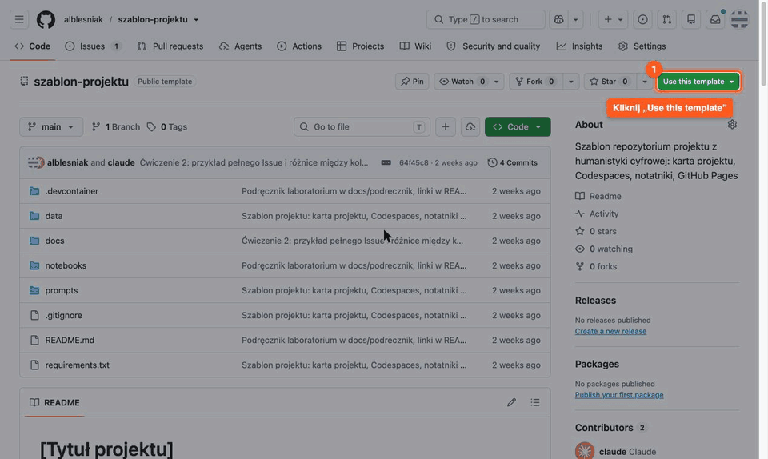
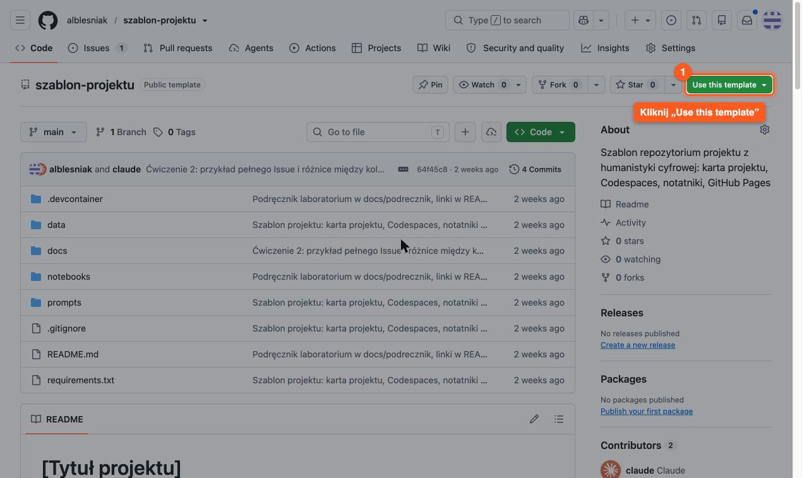
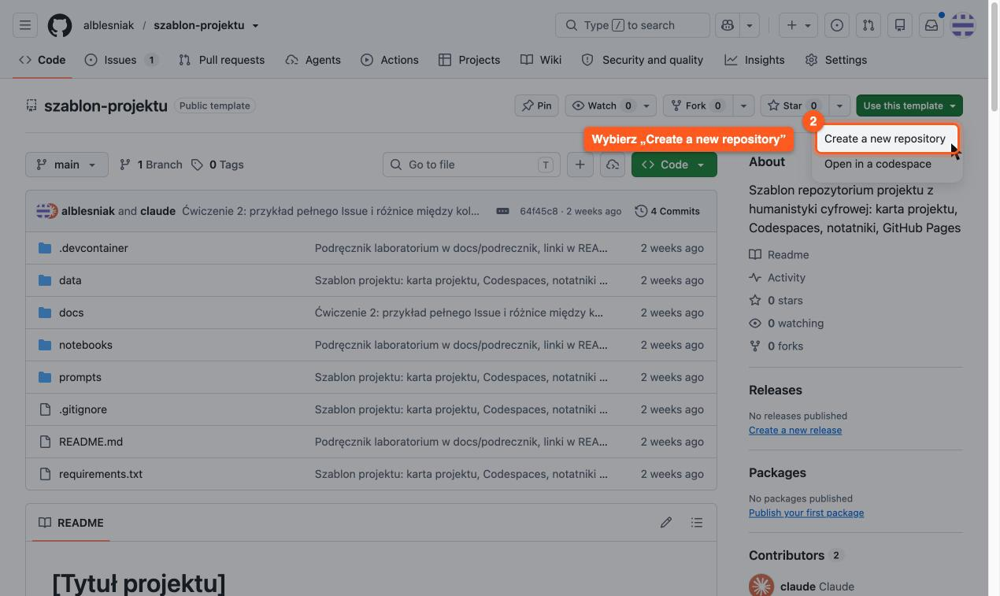
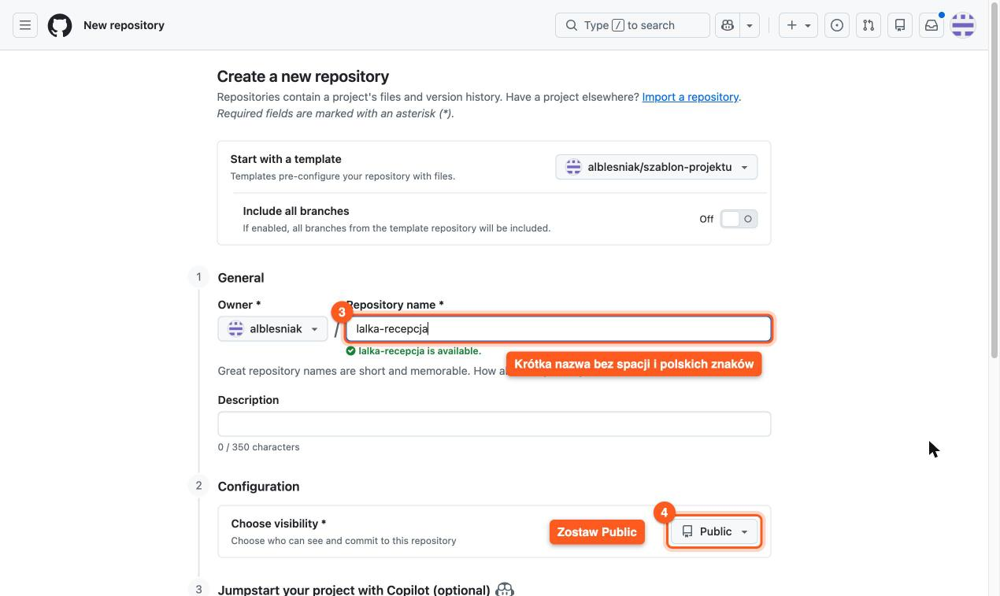
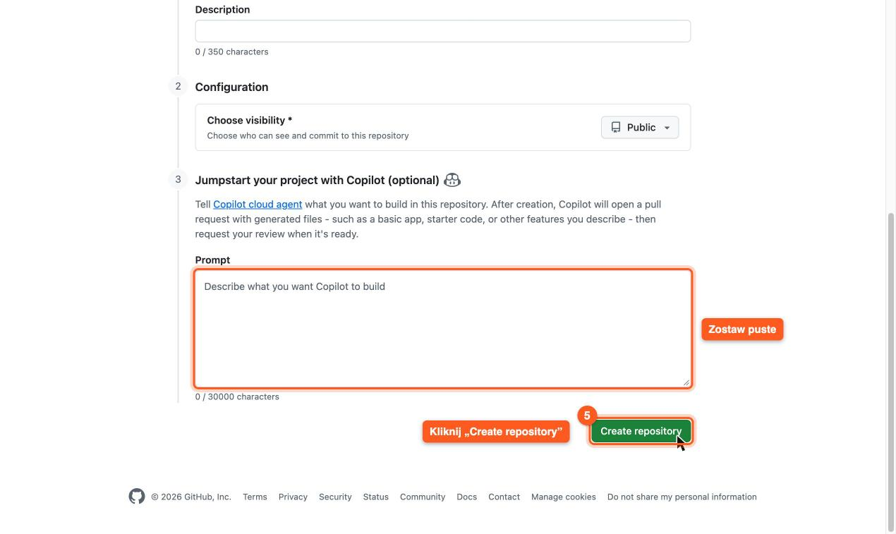
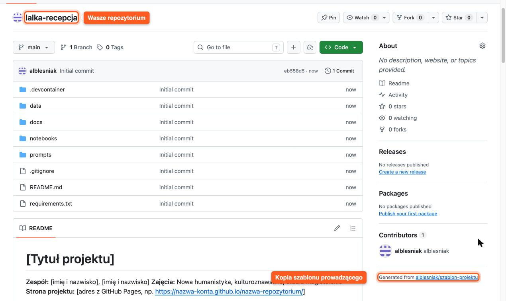
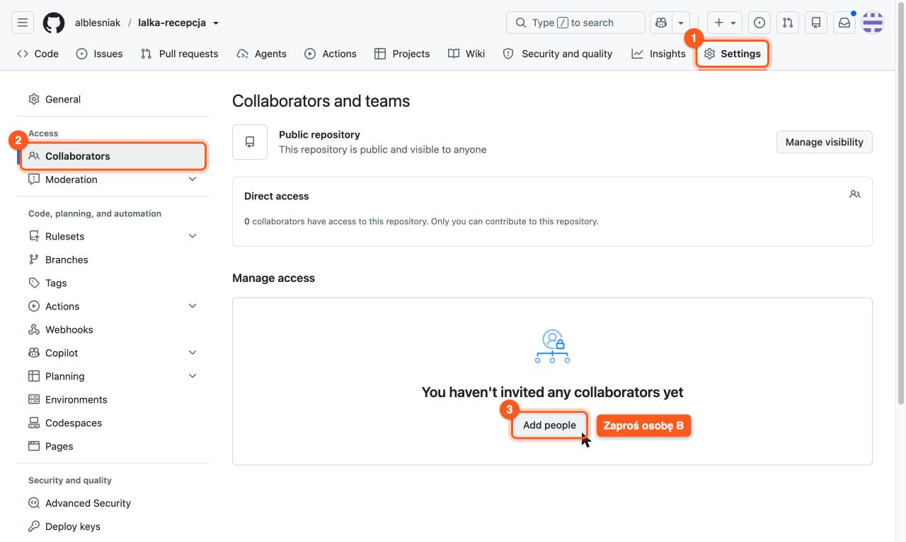
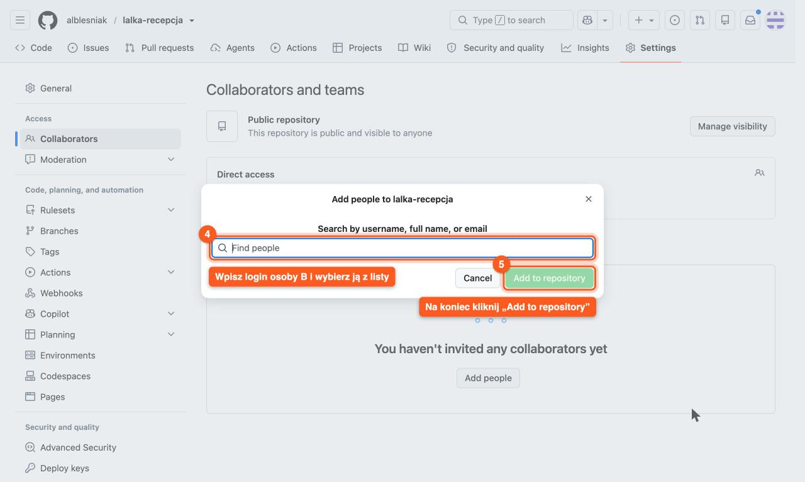

# Ćwiczenie 1. Repozytorium z szablonu

**Cel:** zespół ma własne repozytorium, czyli kopię szablonu, a obie osoby mają do niego dostęp.

> [!NOTE]
> **Co to jest szablon?** Repozytorium przygotowane do kopiowania: ma gotowe foldery, kartę projektu i ustawienia Codespaces. Kopia z szablonu jest niezależna: wasze zmiany nie zmieniają szablonu, a zmiany w szablonie nie trafiają do was. Dlatego nie robimy forka.

▶ Całe ćwiczenie w jednej animacji

## Osoba A: kopia szablonu

**Krok 1.** Zaloguj się na GitHubie i wejdź na [github.com/alblesniak/szablon-projektu](https://github.com/alblesniak/szablon-projektu). Kliknij zielony przycisk **Use this template**.

> [!TIP]
> Nie widzisz przycisku **Use this template**? Nie jesteś zalogowany. Kliknij **Sign in** w prawym górnym rogu.

**Krok 2.** Z rozwiniętej listy wybierz **Create a new repository**.

**Krok 3.** Wypełnij formularz:
- **Owner:** twoje konto (jest wybrane od razu);
- **Repository name:** krótka nazwa bez spacji i polskich znaków, np. `lalka-recepcja`. Zielony komunikat *is available* oznacza, że nazwa jest wolna;
- **Choose visibility:** zostaw **Public**.

**Krok 4.** Przewiń w dół. Pole **Jumpstart your project with Copilot** zostaw **puste**: inaczej Copilot sam dopisze do repozytorium pliki, których nie chcecie. Kliknij **Create repository**.

**Krok 5.** Po kilku sekundach (napis *Generating your repository…* to normalne) zobaczysz własne repozytorium. Po lewej u góry jest jego adres: `twój-login / nazwa`, a w prawej kolumnie dopisek *Generated from alblesniak/szablon-projektu*.

## Osoba A: zaproszenie osoby B

**Krok 6.** W repozytorium zespołu kliknij **Settings** (1), po lewej **Collaborators** (2), a potem **Add people** (3).

> [!IMPORTANT]
> GitHub może poprosić o potwierdzenie, że to na pewno ty (**Confirm access**). Potwierdź w aplikacji GitHub Mobile albo wybierz **Send a code via email** i wpisz kod z maila. Zobacz [Co jeśli…](09_co_jesli.md#confirm-access).

**Krok 7.** Wpisz login osoby B (4), wybierz ją z listy, która się pojawi, i kliknij **Add to repository** (5).

## Osoba B: przyjęcie zaproszenia

**Krok 8.** Otwórz maila od GitHuba z zaproszeniem albo wejdź na [github.com/notifications](https://github.com/notifications) i kliknij **Accept invitation**. Zaproszenie jest ważne 7 dni.

> [!TIP]
> **Dlaczego Public?** Darmowe GitHub Pages działa tylko z repozytoriów publicznych. Surowych danych i kluczy API i tak nie publikujemy, o czym w ćwiczeniu 5.

✅ **Punkt kontrolny:** obie osoby otwierają repozytorium zespołu i widzą README z kartą projektu.

[← Spis treści](README.md) · [Ćwiczenie 2 →](02_issues.md)
