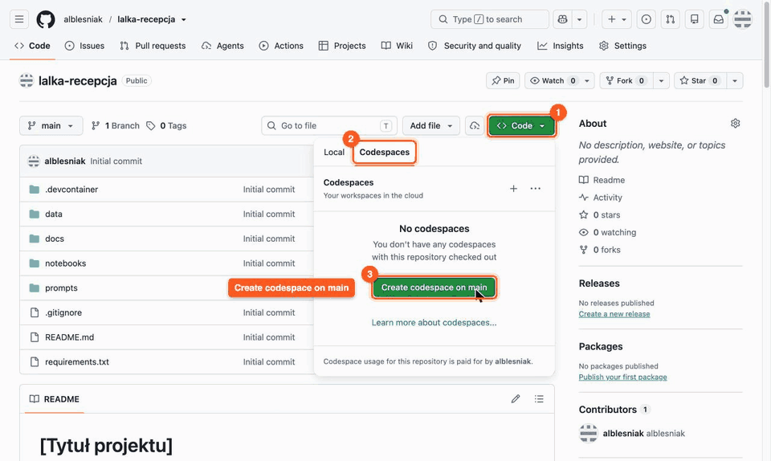
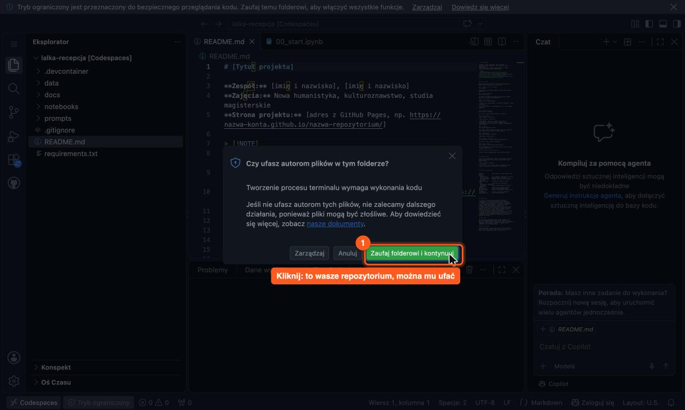
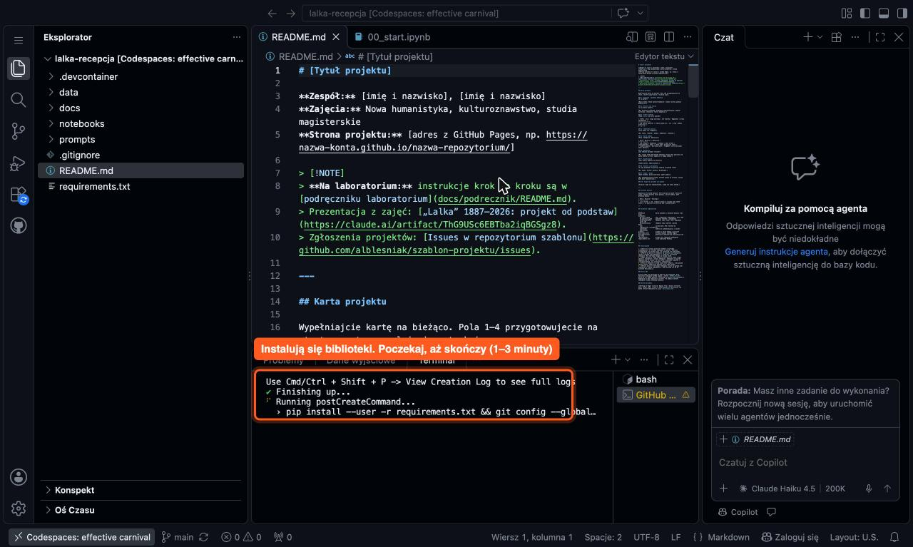
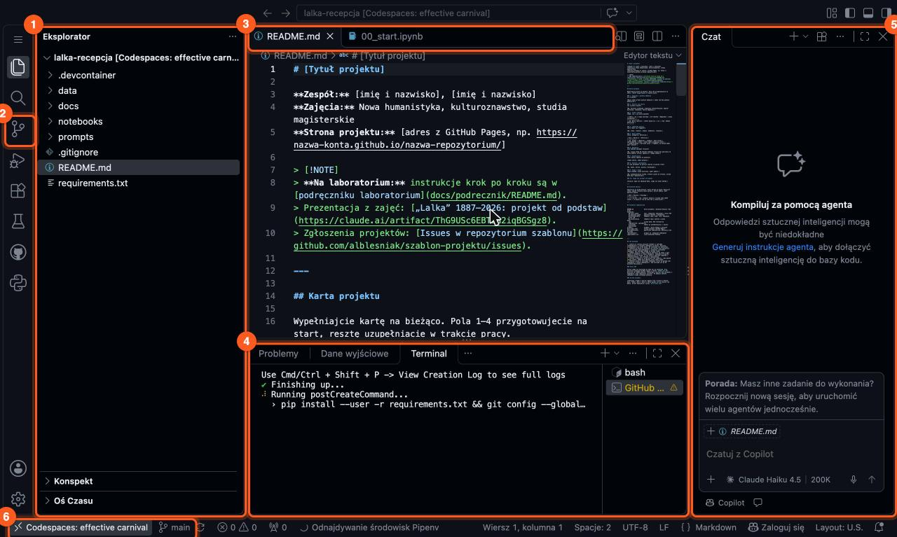
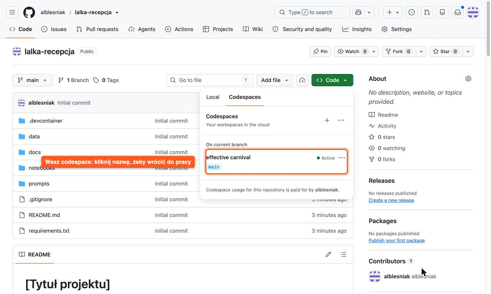
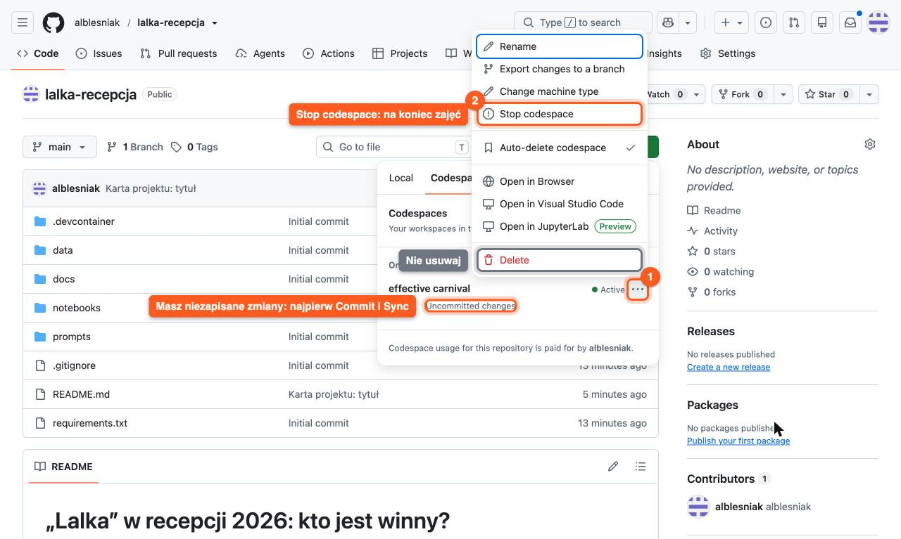

# Ćwiczenie 3. Uruchomienie Codespaces

**Cel:** każda osoba ma własny codespace dla repozytorium zespołu i wie, gdzie co jest.

> [!NOTE]
> **Co to jest codespace?** Komputer w chmurze GitHuba z edytorem VS Code w przeglądarce, z Pythonem i potrzebnymi bibliotekami. Każda osoba ma własny codespace, ale oba pracują na tym samym repozytorium. Codespace to biurko, repozytorium to teczka: co nie trafiło do teczki, istnieje tylko na biurku.

> [!TIP]
> **Polski czy angielski?** VS Code w codespace bierze język z przeglądarki. Na zrzutach jest polski. Jeśli masz angielski, nazwy w nawiasach podpowiadają, czego szukać, np. **Kontrola źródła** (*Source Control*).

▶ Start codespace w jednej animacji

## Kroki (oboje)

**Krok 1.** W repozytorium zespołu kliknij zielony przycisk **Code** (1), zakładkę **Codespaces** (2), a potem **Create codespace on main** (3). Codespace otworzy się w nowej karcie.

Jeśli GitHub zapyta o sekret `OPENAI_API_KEY`, wpisz klucz albo pomiń ten krok (klucz można dodać później, patrz niżej).

**Krok 2.** VS Code zapyta: **Czy ufasz autorom plików w tym folderze?** (*Do you trust the authors…*). To wasze repozytorium, więc kliknij **Zaufaj folderowi i kontynuuj** (*Trust Folder & Continue*).

> [!WARNING]
> Jeśli klikniesz **Anuluj**, codespace zostanie w **trybie ograniczonym**: notatniki i terminal nie zadziałają. Naprawisz to w niebieskim pasku u góry okna: **Zarządzaj** (*Manage*), a potem przycisk zaufania folderowi.

**Krok 3.** Poczekaj, aż zainstalują się biblioteki. W dolnym panelu (**Terminal**) widać napis *Running postCreateCommand… pip install*. Przy pierwszym uruchomieniu trwa to 1–3 minuty. Instalacja jest skończona, gdy w terminalu pojawi się zwykły wiersz z `$` na końcu.

**Krok 4.** Poznaj okno:

| # | Co to jest | Do czego służy |
|---|---|---|
| 1 | **Eksplorator** (*Explorer*) | lista plików i folderów repozytorium |
| 2 | **Kontrola źródła** (*Source Control*), ikona rozgałęzienia | zapis zmian: Commit i Sync (ćwiczenie 5) |
| 3 | karty otwartych plików | tu otwierają się README, notatniki itd. |
| 4 | dolny panel: **Terminal** | komunikaty instalacji; zamykasz go **×** po prawej, otwierasz przez menu **☰ → Terminal → Nowy terminal** (*New Terminal*) |
| 5 | **Czat** (*Chat*) z Copilotem | pytania do asystenta AI (ćwiczenie 4) |
| 6 | dolny pasek | nazwa codespace, gałąź `main` i strzałki synchronizacji |

✅ **Punkt kontrolny:** w przeglądarce działa codespace, po lewej widać pliki repozytorium, a w terminalu instalacja jest zakończona.

## Powrót do pracy i koniec pracy

> [!IMPORTANT]
> **Powrót do pracy:** nie zakładaj nowego codespace. W repozytorium kliknij **Code** → **Codespaces** i kliknij nazwę istniejącego codespace (GitHub nadaje losowe nazwy, np. *effective carnival*). To samo znajdziesz na [github.com/codespaces](https://github.com/codespaces).

**Koniec pracy:** najpierw **Commit** i **Sync** (ćwiczenie 5), potem przy codespace kliknij **⋯** (1) → **Stop codespace** (2). Napis **Uncommitted changes** oznacza, że coś nie zostało zapisane commitem. **Delete** usuwa codespace razem z niezapisaną pracą: nie klikaj.

> [!NOTE]
> Codespace sam zatrzymuje się po 30 minutach bezczynności, a nieużywany przez dłuższy czas jest automatycznie usuwany. Dlatego pracy nie trzymamy w codespace, tylko w repozytorium: Commit i Sync.
>
> **Limit:** ok. 60 godzin pracy miesięcznie na darmowym koncie, ok. 90 godzin z GitHub Education.

> [!TIP]
> **Klucz API później:** w repozytorium **Settings → Secrets and variables → Codespaces → New repository secret**, nazwa `OPENAI_API_KEY`. Potem zatrzymaj i uruchom codespace ponownie, żeby zobaczył klucz. Klucza nigdy nie wpisujemy do kodu ani do notatnika.

[← Ćwiczenie 2](02_issues.md) · [Spis treści](README.md) · [Ćwiczenie 4 →](04_notatniki.md)
