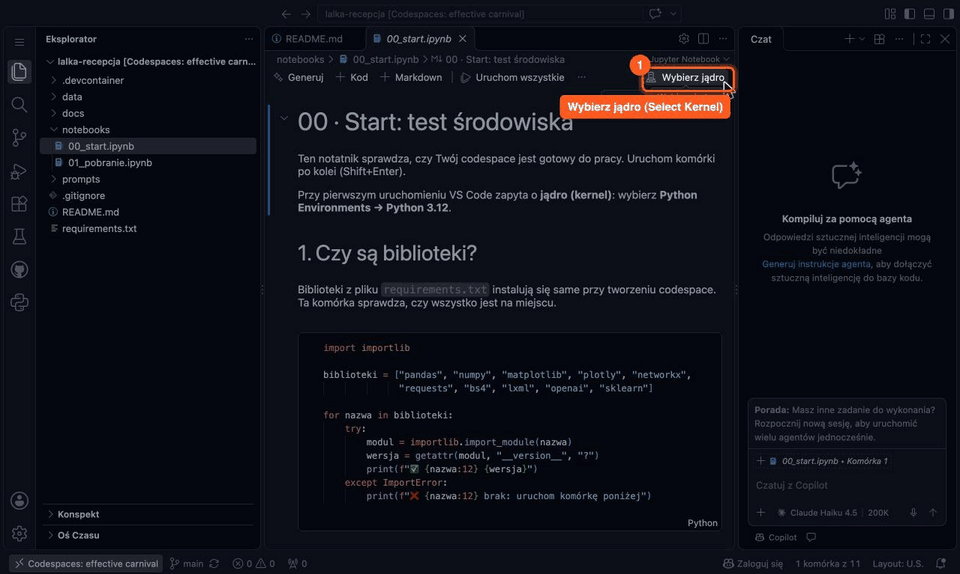
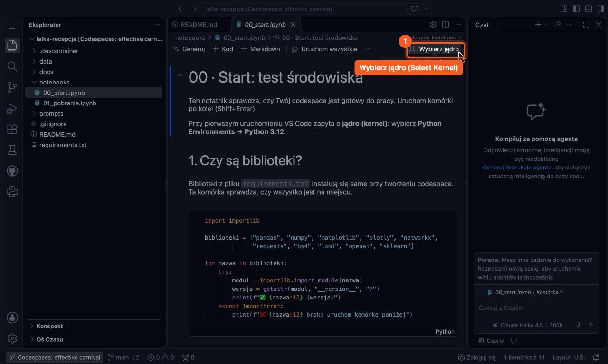
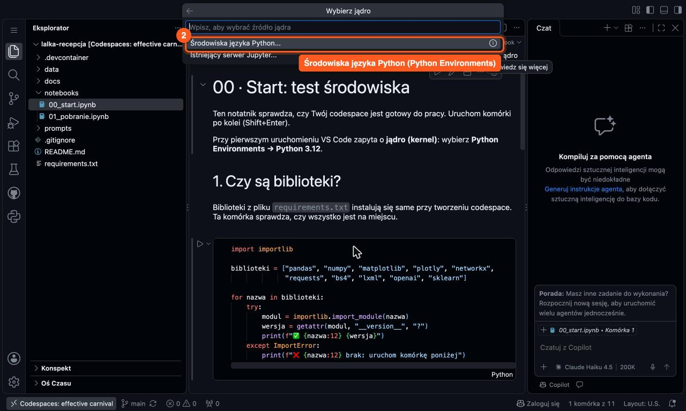
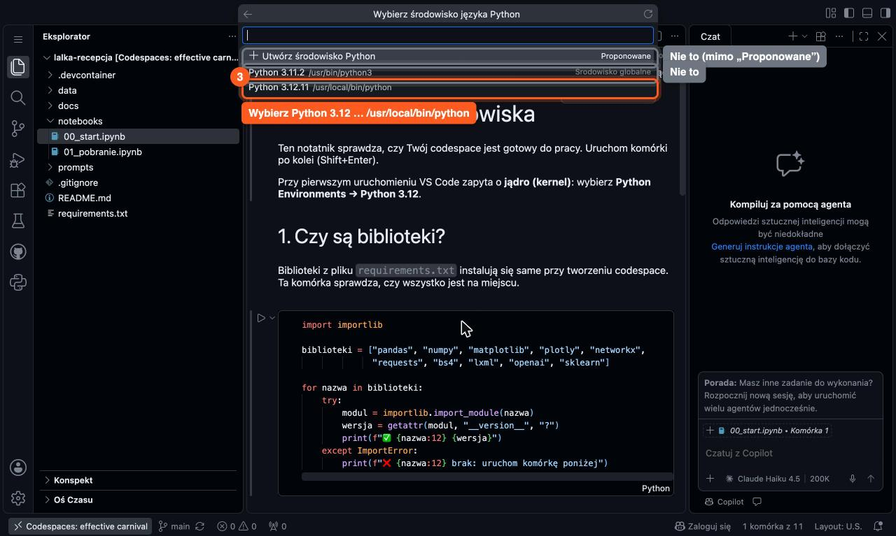
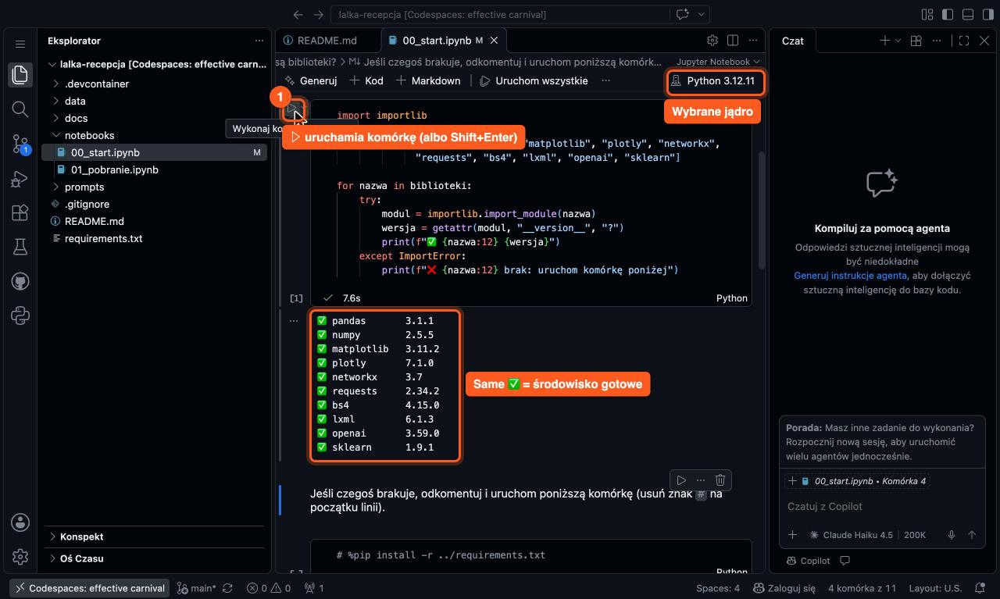
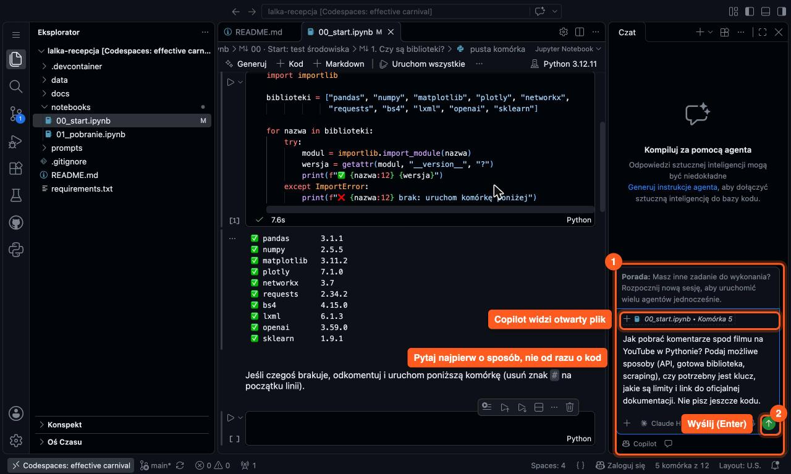
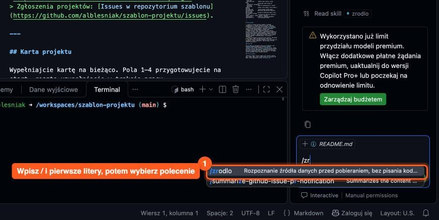

# Ćwiczenie 4. Praca z notatnikami

**Cel:** uruchomić notatnik i poznać rytm pracy: prompt → kod → wynik. Osoba A zaczyna pobieranie tekstów, osoba B zbiera źródła w przeglądarce.

> [!NOTE]
> **Notatnik (.ipynb)** składa się z komórek tekstu (opis, prompt) i komórek kodu. Komórkę uruchamiasz klawiszami **Shift+Enter**, a wynik pojawia się pod nią. **Jądro (kernel)** to program, który wykonuje kod. Wybierasz je raz, przy pierwszym uruchomieniu notatnika.

<details>
<summary>▶ Wybór jądra w jednej animacji</summary>



</details>

## Oboje: test środowiska

**Krok 1.** W **Eksploratorze** otwórz `notebooks/00_start.ipynb`.

> [!TIP]
> Notatnik wygląda jak tekst z nawiasami `{ }` zamiast komórek? Zamknij kartę (×) i otwórz plik jeszcze raz z Eksploratora. Zobacz [Co jeśli…](09_co_jesli.md#notatnik-json).

**Krok 2.** W prawym górnym rogu notatnika kliknij **Wybierz jądro** (*Select Kernel*).



**Krok 3.** U góry okna pojawi się lista. Wybierz **Środowiska języka Python…** (*Python Environments…*).



**Krok 4.** Wybierz **Python 3.12… /usr/local/bin/python**.

> [!WARNING]
> **To najczęstsza pułapka.** Nie wybieraj **Utwórz środowisko Python** (*Create Python Environment*), mimo że ma etykietę *Proponowane* (*Recommended*). Nie wybieraj też **Python 3.11 /usr/bin/python3**. W obu przypadkach notatnik nie znajdzie bibliotek i komórki pokażą ❌.



**Krok 5.** Najedź na pierwszą komórkę kodu i kliknij **▷** po jej lewej stronie albo kliknij w komórkę i naciśnij **Shift+Enter**. Pod komórką pojawi się lista bibliotek: same ✅ oznaczają, że środowisko jest gotowe. W prawym górnym rogu widać teraz wybrane jądro: **Python 3.12…**.



**Krok 6.** Uruchamiaj kolejne komórki po kolei. Komórka z kluczem pokaże ✅ albo ❌; bez klucza też można pracować dalej.

## Osoba A: zadanie #3, z Copilotem

**Krok 7.** Otwórz `notebooks/01_pobranie.ipynb` i wybierz jądro tak jak w krokach 2–4. W komórce **Parametry** zostaw przykład („Lalka” z Wolnych Lektur) albo wpisz własne źródło.

**Krok 8.** Przy **Kroku 1A** jest prompt dla modelu. Kliknij dwa razy w komórkę z promptem, żeby zobaczyć jej tekst, zaznacz prompt i skopiuj go (**Ctrl+C**, na Macu **Cmd+C**).

**Krok 9.** Wklej prompt w polu **Czatuj z Copilot** po prawej (1) i wyślij strzałką albo klawiszem **Enter** (2). Copilot widzi otwarty plik, więc wie, nad czym pracujesz.



**Krok 10.** Skopiuj kod z odpowiedzi Copilota (ikona kopiowania przy bloku kodu), wklej go do pustej komórki pod promptem i uruchom.

**Krok 11.** Porównaj wynik z sekcją „Po uruchomieniu powinieneś zobaczyć”. Jeśli jest błąd, wpisz w Czacie `/wyjasnij` i wklej treść błędu: Copilot wyjaśni go po polsku i zaproponuje najmniejszą poprawkę. Zapisz notatnik (**Ctrl+S**, na Macu **Cmd+S**).

**Polecenia tego szablonu.** Zamiast kopiować prompt możesz użyć poleceń przygotowanych dla kursu. Wpisz w Czacie `/`, poczekaj chwilę na listę, dopisz pierwsze litery i wybierz polecenie, np. `/zrodlo` (rozpoznanie źródła) albo `/pobierz` (próbka danych). Po nazwie polecenia opisz, o co chodzi. W odpowiedzi pojawi się wtedy znacznik **Read skill**: Copilot wczytał polecenie. Wszystkie polecenia: [przepisy na dane](../przepisy/README.md#polecenia-copilota-w-tym-szablonie). Jak działają i jak napisać własne: [AI w projekcie](10_ai_w_projekcie.md).



> [!TIP]
> **Najpierw pytaj o sposób, potem o kod.** Darmowy Copilot ma ograniczoną liczbę pytań w miesiącu, więc lepiej zadać jedno dobrze opisane pytanie niż pięć krótkich. Nie masz Copilota? Ten sam prompt wklej do dowolnego czatu AI w drugiej karcie przeglądarki, a kod przenieś do notatnika.

## Osoba B: zadanie #4, na github.com

**Krok 12.** W repozytorium kliknij **Add file → Create new file**. Jako nazwę wpisz `data/processed/zrodla.csv`; ukośnik sam utworzy folder.

**Krok 13.** Wklej nagłówek i opisz 3–5 źródeł tekstów do waszego projektu, jedno w wierszu:

```
zrodlo,co_bierzemy,adres,ile_tekstow,licencja_lub_regulamin
Wolne Lektury,„Lalka” t. I–II,https://wolnelektury.pl,2,domena publiczna
```

**Krok 14.** Kliknij **Commit changes…**, wpisz opis `Lista źródeł, closes #4`, zostaw **Commit directly to the main branch** i kliknij **Commit changes**. Tak samo wygląda zapis każdej zmiany na github.com: zobacz zrzuty w [ćwiczeniu 5](05_commit_i_sync.md#w-przeglądarce-githubcom).

> [!WARNING]
> **Notatnik ma jednego właściciela.** Gdy dwie osoby pracują równolegle w tym samym notatniku, prawie zawsze kończy się to trudnym konfliktem (ćwiczenie 6). Właściciela notatnika widać w Issue.

> [!TIP]
> Wyniki komórek zapisują się w pliku notatnika. To normalne, że po samym uruchomieniu notatnik jest oznaczony jako zmieniony (litera **M** przy nazwie).

✅ **Punkt kontrolny:** A ma wynik kroku 1A, a w `data/raw/` są pobrane pliki. B widzi `zrodla.csv` na github.com, a Issue #4 jest zamknięte.

[← Ćwiczenie 3](03_codespaces.md) · [Spis treści](README.md) · [Ćwiczenie 5 →](05_commit_i_sync.md)
