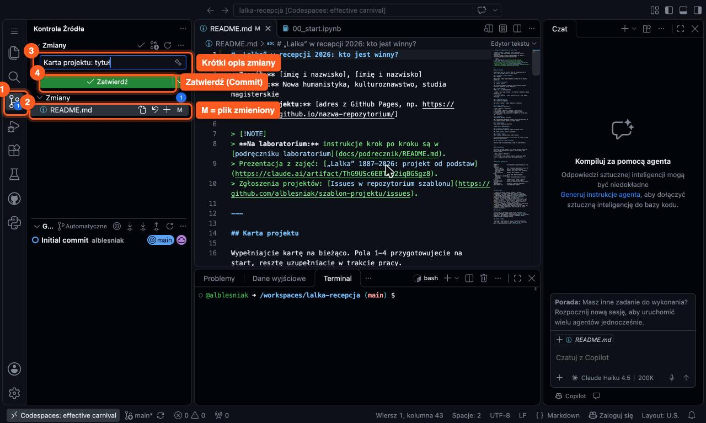
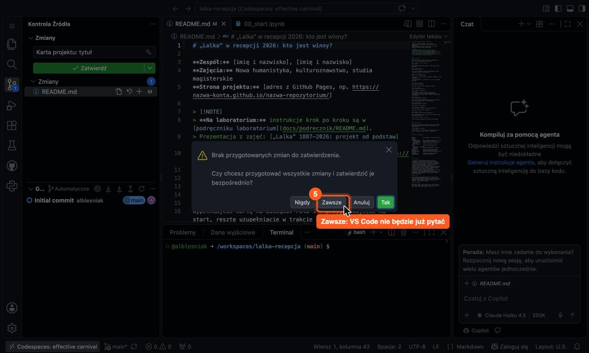
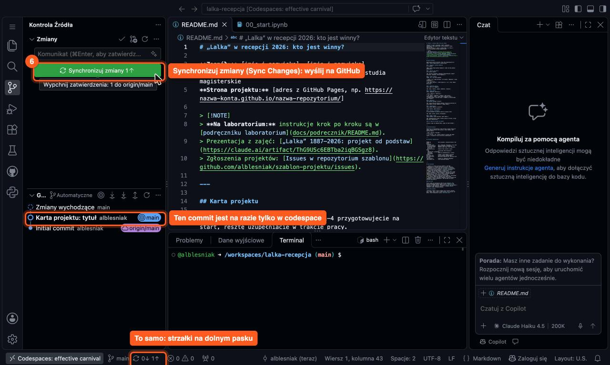
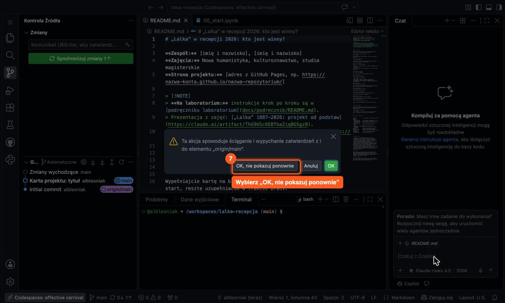
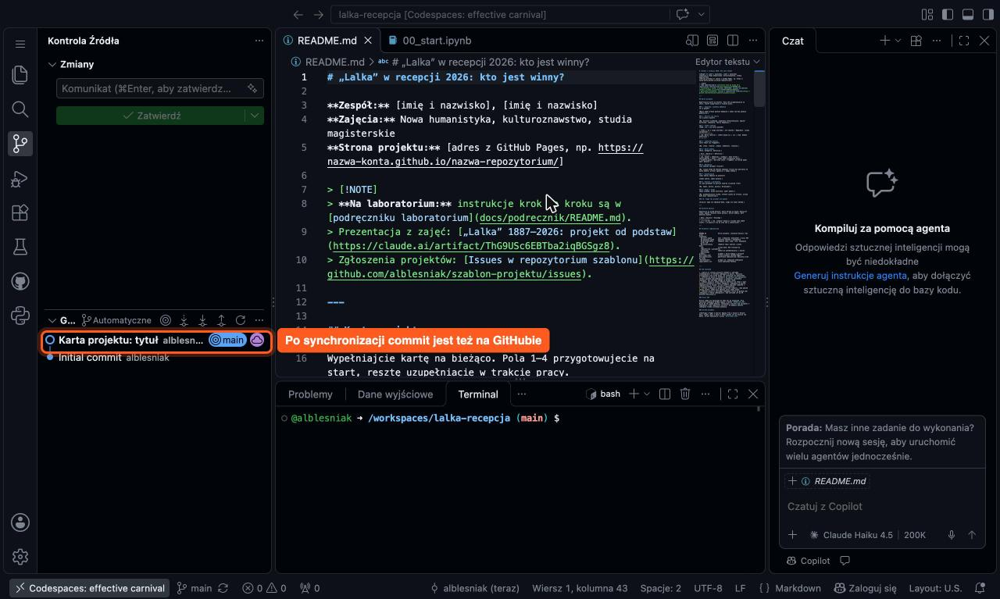
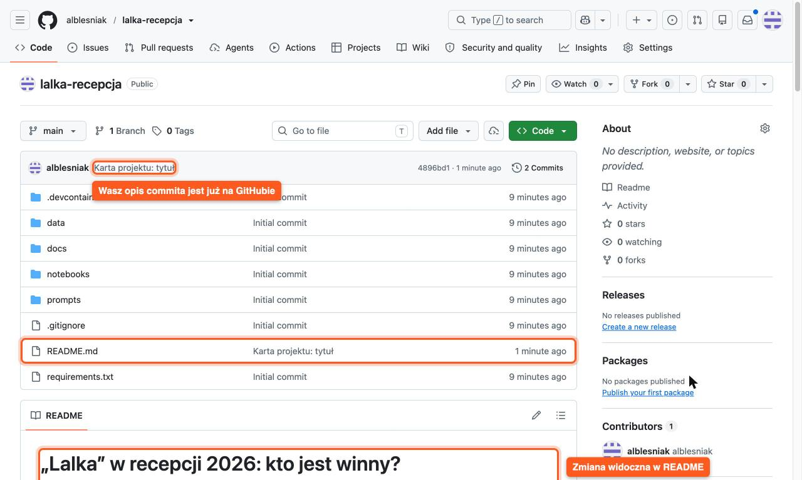
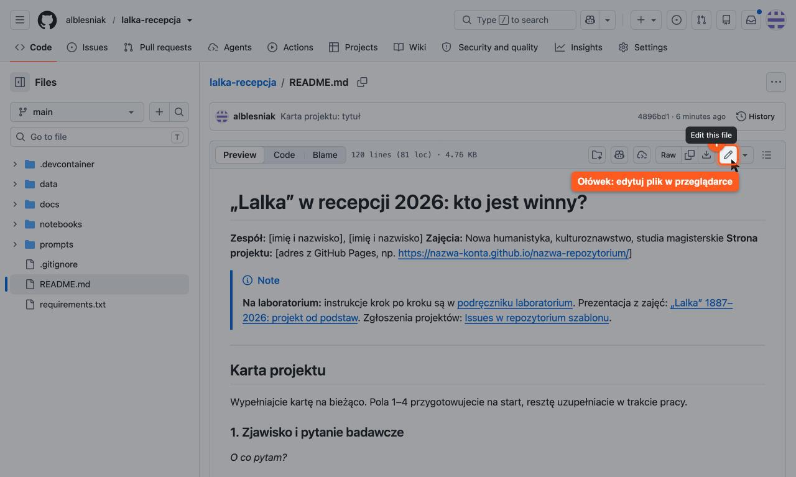
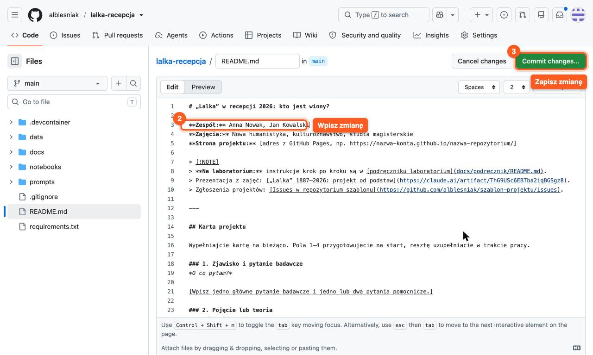
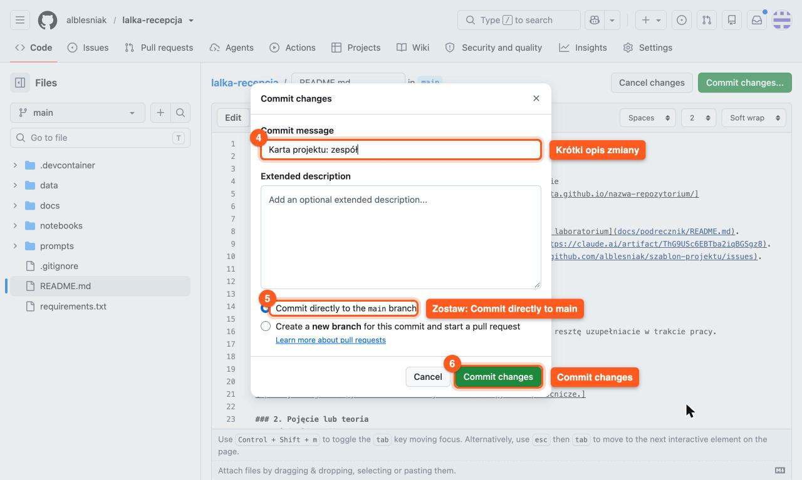

# Ćwiczenie 5. Commit i Sync

**Cel:** zapisać pracę w repozytorium i zobaczyć, że dwie osoby mogą edytować różne miejsca tego samego pliku bez konfliktu.

> [!NOTE]
> **Commit** to zapisana zmiana z opisem, na razie tylko w twoim codespace. **Sync** wysyła twoje commity na GitHub i pobiera zmiany innych. Zmiana jest w repozytorium dopiero po Sync.

## Rytm pracy (zawsze)

1. **Na początku:** Sync, żeby pobrać zmiany innych.
2. **Praca:** zapisuj pliki (**Ctrl+S**, na Macu **Cmd+S**).
3. **Na koniec:** Commit z krótkim opisem, potem Sync.
4. **Sprawdzenie:** na github.com przy liście plików widać twój opis commita.

▶ Commit i Sync w jednej animacji

## W codespace

**Krok 1.** Zapisz zmieniony plik. Po lewej kliknij **Kontrola źródła** (*Source Control*), ikonę rozgałęzienia (1). Na liście **Zmiany** (*Changes*) są zmienione pliki: **M** to plik zmieniony, **U** nowy (2). W polu **Komunikat** (*Message*) wpisz krótki opis zmiany (3) i kliknij **Zatwierdź** (*Commit*) (4).

**Krok 2.** Przy pierwszym commicie VS Code zapyta, czy przygotować wszystkie zmiany. Kliknij **Zawsze** (*Always*) (5), wtedy więcej nie zapyta.

**Krok 3.** Commit jest zapisany, ale na razie tylko w codespace. Kliknij **Synchronizuj zmiany** (*Sync Changes*) (6). Ten sam efekt dają strzałki na dolnym pasku.

**Krok 4.** Przy pierwszej synchronizacji VS Code poprosi o potwierdzenie. Kliknij **OK, nie pokazuj ponownie** (*OK, Don't Show Again*) (7). Jeśli później zapyta, czy okresowo uruchamiać `git fetch`, odpowiedz **Tak** (*Yes*): wtedy sam sprawdza, czy druga osoba czegoś nie dodała.

**Krok 5.** Po synchronizacji przy commicie widać dwie ikony: twoją gałąź `main` i chmurkę (GitHub). Commit jest w repozytorium.

**Krok 6.** Sprawdź na github.com: przy liście plików widać opis twojego commita, a w README zmianę.

## W przeglądarce: github.com

Osoba B może zmieniać pliki bez codespace, prosto na github.com.

**Krok 7.** Otwórz plik, np. `README.md`, i kliknij **ołówek** (*Edit this file*).

**Krok 8.** Wprowadź zmianę (2) i kliknij **Commit changes…** (3).

**Krok 9.** Wpisz krótki opis zmiany (4). GitHub z Copilotem może sam zaproponować opis: zamień go na własny. Zostaw **Commit directly to the main branch** (5) i kliknij **Commit changes** (6).

## Ćwiczenie: README we dwoje

- **Osoba A, w codespace:** uzupełnij w `README.md` pola 1–2 karty projektu. Commit z opisem `Karta projektu: pola 1–2, closes #1`, potem Sync. Zrób też commit notatnika: `Krok 1A: pobranie próbki, closes #3`, i Sync.
- **Osoba B, w tym samym czasie, na github.com:** w `README.md` uzupełnij pola 3–4 (kroki 7–9), opis `Karta projektu: pola 3–4, closes #2`.
- **Osoba A:** jeszcze raz **Synchronizuj zmiany**. W codespace README ma teraz obie części.

> [!NOTE]
> 👤 **Pracujesz w pojedynkę?** Zrób to samo w dwóch kartach, dokładnie w tej kolejności:
> 1. **Karta z codespace:** uzupełnij w `README.md` pola 1–2, zapisz plik i kliknij **Zatwierdź** z opisem `Karta projektu: pola 1–2, closes #1`. Tak samo zatwierdź notatnik: `Krok 1A: pobranie próbki, closes #3`. **Nie klikaj jeszcze Synchronizuj zmiany.**
> 2. **Karta z github.com:** odśwież stronę, otwórz `README.md` → ołówek, uzupełnij pola 3–4 i zrób commit z opisem `Karta projektu: pola 3–4, closes #2` (kroki 7–9). Na github.com nie ma jeszcze pól 1–2: to normalne, bo commity z codespace czekają na Sync.
> 3. **Karta z codespace:** kliknij **Synchronizuj zmiany**. Git połączy obie zmiany i `README.md`, w codespace i na github.com, ma teraz pola 1–4. Komunikat „divergent branches”? Zobacz [Co jeśli…](09_co_jesli.md#divergent).
>
> Tak zobaczysz to samo co para: dwie zmiany tego samego pliku zrobione w dwóch miejscach łączą się bez konfliktu.

> [!TIP]
> **Dlaczego nie było konfliktu?** Git sam łączy zmiany, jeśli dotyczą różnych miejsc w pliku. Konflikt powstaje tylko wtedy, gdy dwie osoby zmienią tę samą linię. To przećwiczycie w ćwiczeniu 6.

> [!IMPORTANT]
> **Co nie trafia do repozytorium:** folder `data/raw/` (wpisany do pliku `.gitignore`) i klucz API. Dlatego pliki z `data/raw/` nie pojawiają się w Kontroli źródła. Publikujemy tylko `data/processed/`.

✅ **Punkt kontrolny:** README na github.com ma uzupełnione pola 1–4, Issues #1–#4 są zamknięte, a w historii (link **Commits** nad listą plików) są commity obu osób. W pojedynkę: twoje commity z codespace i z github.com.

[← Ćwiczenie 4](04_notatniki.md) · [Spis treści](README.md) · [Ćwiczenie 6 →](06_konflikt.md)
