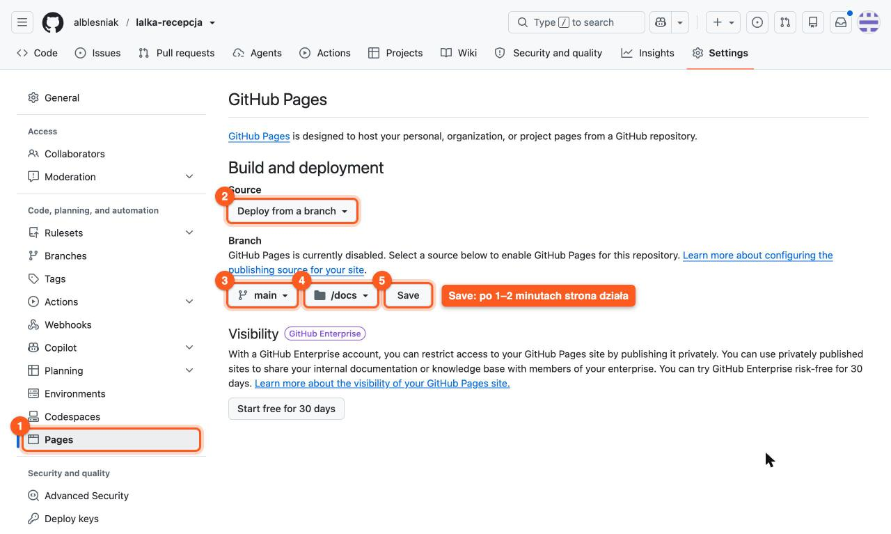

# Ćwiczenie 7. Publikacja na GitHub Pages

**Cel:** strona projektu działa pod publicznym adresem.

> [!NOTE]
> **GitHub Pages** zamienia pliki z folderu `docs/` w stronę internetową. Każdy commit w `docs/` aktualizuje stronę po minucie lub dwóch. Strona startowa to plik `docs/index.html`.

> [!NOTE]
> 👤 **Pracujesz w pojedynkę?** Zrób obie części po kolei w karcie z github.com, a na dole strony wpisz swoje imię. Na koniec w karcie z codespace kliknij **Synchronizuj zmiany** (albo strzałki na dolnym pasku), żeby codespace miał zmiany z github.com.

## Osoba B: zadanie #5, na github.com

1. Otwórz `docs/index.html` → ołówek.
2. Zamień `[Tytuł projektu]` (w dwóch miejscach: w `<title>` i w nagłówku) na tytuł waszego projektu. W sekcji „Pytanie badawcze” wpisz pytanie, a na dole imiona zespołu.
3. **Commit changes…**, opis `Strona: tytuł i pytanie, closes #5`, **Commit directly to the main branch**.

## Osoba A: włączenie strony

4. W repozytorium: **Settings → Pages** (1).
5. W sekcji **Build and deployment**: **Source: Deploy from a branch** (2), **Branch: main** (3), folder **/docs** (4) → **Save** (5).

    

6. Po 1–2 minutach odśwież stronę ustawień. U góry pojawi się adres strony i przycisk **Visit site**.
7. Wpiszcie ten adres w `README.md`, w polu „Strona projektu”, i zróbcie commit.

> [!TIP]
> **Strona pokazuje błąd 404?** Sprawdź, czy wybrany jest folder **/docs**, i odczekaj 2 minuty. Postęp publikacji widać w zakładce **Actions**.

✅ **Punkt kontrolny:** strona zespołu działa pod adresem `nazwa-konta.github.io/nazwa-repozytorium`, a README zawiera do niej link.

[← Ćwiczenie 6](06_konflikt.md) · [Spis treści](README.md) · [Ćwiczenie 8 →](08_zgloszenie.md)
