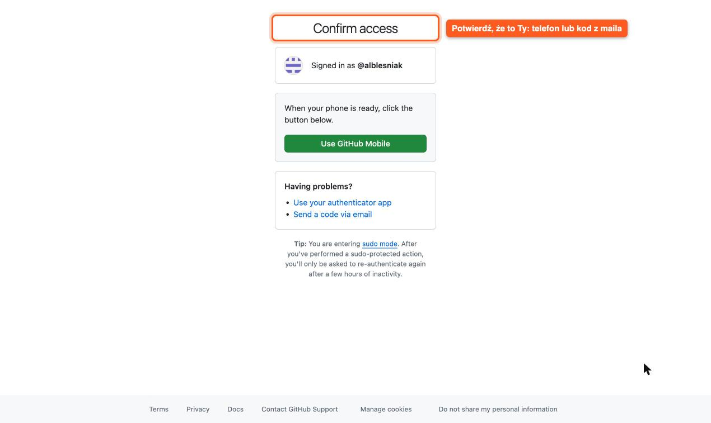
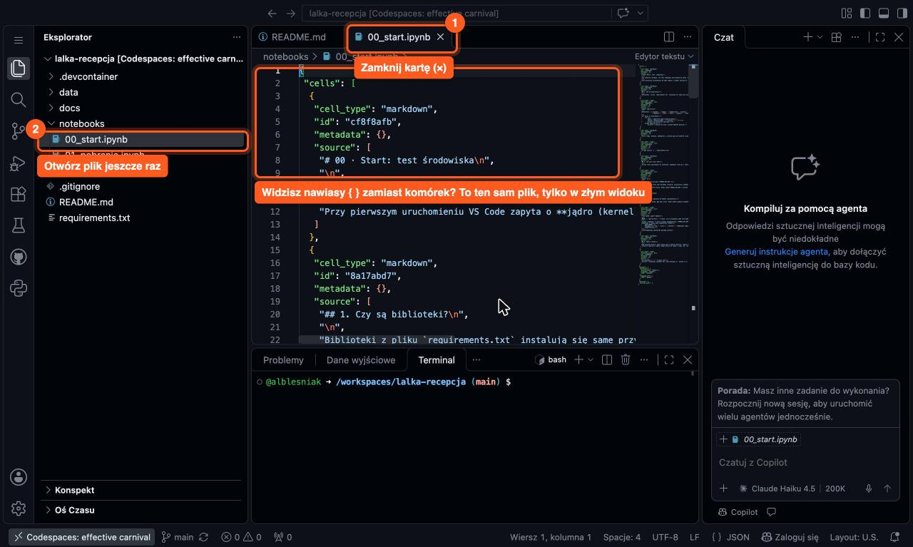
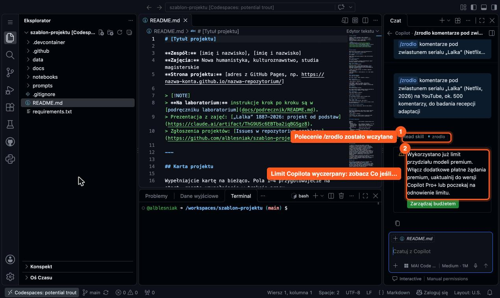

# Co jeśli… Najczęstsze problemy

Zanim zawołasz prowadzącego, znajdź tu swój objaw. Każdy z nich zdarzył się przy przygotowywaniu tego podręcznika.

## GitHub

<a id="confirm-access"></a>
### GitHub pokazuje „Confirm access”

GitHub chce się upewnić, że to ty, zanim pozwoli zmienić ustawienia repozytorium (np. dodać współpracownika). Potwierdź w aplikacji **GitHub Mobile** albo kliknij **Send a code via email** i wpisz kod z maila. Potem przez kilka godzin nie zapyta ponownie.



### Nie widzę przycisku „Use this template”

Nie jesteś zalogowany. Kliknij **Sign in** w prawym górnym rogu.

### Osoba B nie widzi repozytorium

Osoba B musi przyjąć zaproszenie: mail od GitHuba albo [github.com/notifications](https://github.com/notifications) → **Accept invitation**. Zaproszenie wygasa po 7 dniach; wtedy osoba A zaprasza jeszcze raz.

### Opis commita na github.com wpisał się sam

To podpowiedź Copilota. Zaznacz ją i wpisz własny, krótki opis, np. `Karta projektu: pola 3–4`.

## Codespace

### Na górze okna jest „Tryb ograniczony”

Przy starcie kliknięto **Anuluj** zamiast **Zaufaj folderowi i kontynuuj**. W niebieskim pasku u góry kliknij **Zarządzaj** (*Manage*) i zaufaj folderowi. Zobacz [ćwiczenie 3, krok 2](03_codespaces.md).

### Codespace długo się uruchamia

Przy pierwszym uruchomieniu instalują się biblioteki (1–3 minuty, w terminalu widać `pip install`). Kolejne uruchomienia są szybsze. Jeśli strona wisi dłużej niż 5 minut, odśwież kartę.

### Założyłem drugi codespace przez pomyłkę

Nic się nie stało, ale pracuj w jednym. Na [github.com/codespaces](https://github.com/codespaces) przy zbędnym codespace: **⋯ → Delete**, tylko jeśli nie ma w nim niezapisanej pracy (**Uncommitted changes**).

## Notatnik

<a id="notatnik-json"></a>
### Notatnik wygląda jak tekst z nawiasami `{ }`

To ten sam plik, tylko otwarty jako tekst, zanim VS Code załadował obsługę notatników. Zamknij kartę (1) i otwórz plik jeszcze raz z Eksploratora (2).



### Komórka z bibliotekami pokazuje ❌

Najczęściej wybrane jest złe jądro. Spójrz w prawy górny róg notatnika: musi być **Python 3.12…**. Jeśli jest coś innego (np. `.venv` albo **Python 3.11**), kliknij tę nazwę i wybierz **Środowiska języka Python… → Python 3.12… /usr/local/bin/python** (zobacz [ćwiczenie 4, krok 4](04_notatniki.md)).

Jeśli jądro jest dobre, a ❌ zostaje, instalacja mogła się jeszcze nie skończyć: poczekaj, aż terminal skończy `pip install`, albo uruchom komórkę z `%pip install -r ../requirements.txt` (usuń `#` na początku linii).

### Notatnik nic nie robi po Shift+Enter

Sprawdź, czy wybrane jest jądro (prawy górny róg). Jeśli przy komórce kręci się kółko dłużej niż minutę, kliknij **Przerwij działanie** (*Interrupt*) na pasku notatnika, a potem **Uruchom ponownie** (*Restart*).

## Commit i Sync

### „Need to specify how to reconcile divergent branches”

W codespace otwórz terminal (**☰ → Terminal → Nowy terminal**), wpisz:

```
git config --global pull.rebase false
```

naciśnij Enter i kliknij **Synchronizuj zmiany** jeszcze raz. W nowych codespace to ustawienie jest już włączone.

### Przycisk „Zatwierdź” jest szary

Nie ma nic do zapisania albo nie wpisano opisu. Zapisz plik (**Ctrl+S**) i wpisz opis w polu **Komunikat**.

### Przy codespace widać „Uncommitted changes”

W codespace są zmiany niezapisane commitem. Otwórz codespace, zrób **Zatwierdź** i **Synchronizuj zmiany**, dopiero potem **Stop codespace**.

## Copilot

### Nie ma czatu Copilota albo prosi o zalogowanie

Copilot musi być włączony na twoim koncie GitHub. Wejdź na [github.com/settings/copilot](https://github.com/settings/copilot) i włącz bezpłatny plan (Copilot Free). Jeśli masz status studenta w GitHub Education, możesz mieć szerszy plan. Potem w codespace kliknij na dolnym pasku **Zaloguj się** (*Sign in*), jeśli jest widoczne.

### Copilot pisze „Wykorzystano już limit przydziału modeli premium”

Skończyła się miesięczna pula zapytań do Copilota. Zmiana modelu na liście nie pomaga, bo wszystkie modele korzystają z tej samej puli. Nie klikaj **Zarządzaj budżetem**, bo tam włącza się płatne zapytania. Limit odnowi się w kolejnym okresie rozliczeniowym. Do tego czasu wklej ten sam prompt do dowolnego czatu AI w drugiej karcie przeglądarki i przenieś kod do notatnika ręcznie; notatniki są przygotowane tak, żeby to działało. Treść polecenia, np. `/zrodlo`, znajdziesz w pliku `.github/skills/zrodlo/SKILL.md`: skopiuj ją do czatu razem ze swoją prośbą.



### Copilot pyta „Czy ufasz autorom plików w tym folderze?”

Funkcje AI działają tylko w zaufanych folderach. Kliknij **Zaufaj folderowi i kontynuuj** i wyślij pytanie jeszcze raz.

### Po wpisaniu `/` nie widać poleceń `/zrodlo`, `/pobierz`…

Tuż po uruchomieniu codespace rozszerzenia jeszcze się włączają (na dolnym pasku: *Trwa aktywowanie rozszerzeń*). Poczekaj chwilę, wyczyść pole Czatu i wpisz `/` jeszcze raz, potem pierwsze litery polecenia. Lista znika po skasowaniu znaków, więc zaczynaj od pustego pola.

[← Spis treści](README.md)
