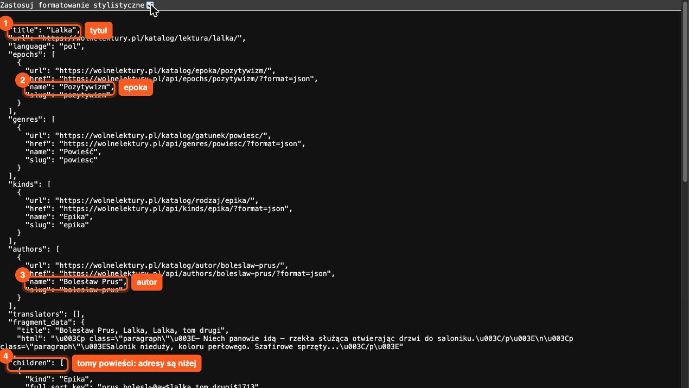
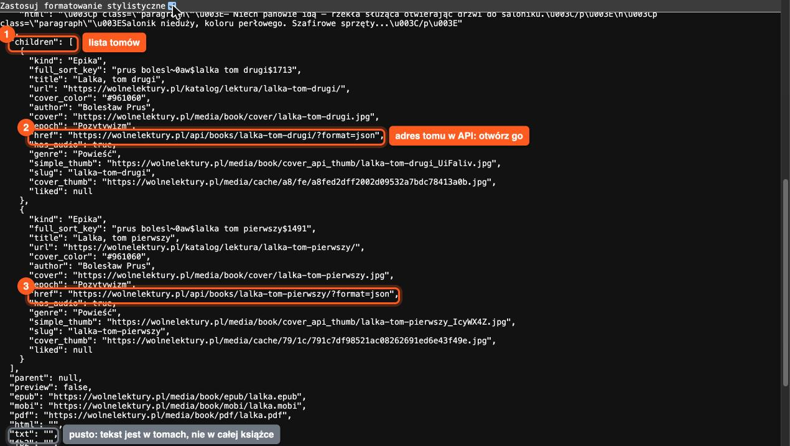
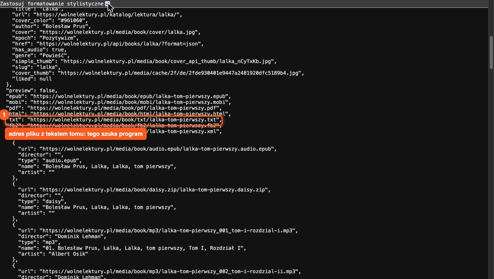

# Przepis 1. API bez klucza: Wolne Lektury

**Kiedy:** potrzebujecie tekstu literackiego z domeny publicznej razem z metadanymi (autor, epoka, gatunek).
**Wynik:** pliki TXT w `data/raw/` i tabela `teksty` z jednym wierszem na tom.

> [!NOTE]
> **Co to jest API?** Adres, pod którym serwis odpowiada nie stroną dla ludzi, tylko danymi dla programów, zwykle w formacie JSON. Wolne Lektury mają otwarte API bez klucza: wpiszcie w przeglądarce [wolnelektury.pl/api/books/lalka/?format=json](https://wolnelektury.pl/api/books/lalka/?format=json), a zobaczycie, co dostaje program.

## Krok po kroku

**Krok 1.** Znajdźcie książkę na [wolnelektury.pl](https://wolnelektury.pl). Końcówka adresu to jej identyfikator (*slug*): `wolnelektury.pl/katalog/lektura/lalka/` → `lalka`.

**Krok 2.** Obejrzyjcie odpowiedź API w przeglądarce: `https://wolnelektury.pl/api/books/lalka/?format=json`. U góry zaznaczcie **Zastosuj formatowanie stylistyczne** (*Pretty-print*), wtedy każde pole jest w osobnym wierszu. Znajdźcie tytuł (1), epokę (2), autora (3) i listę `children` (4).



> [!TIP]
> Bez `?format=json` przeglądarka dostanie tę samą odpowiedź w formacie XML (drzewo znaczników). Program w Pythonie dostaje JSON bez tego dopisku.

**Krok 3.** Przewińcie do `children` (1). „Lalka” ma dwa tomy, więc jej tekst jest w tomach, a nie w całej książce: pole `txt` na dole jest puste. Każdy tom ma własny adres w API (2, 3).



**Krok 4.** Otwórzcie adres jednego tomu. W jego odpowiedzi pole `txt` (1) zawiera adres pliku z tekstem. Tego szuka program: najpierw książka, potem tomy, potem pliki TXT.



**Krok 5.** Wklejcie do notatnika kod wzorcowy z końca przepisu (trzy komórki, jedna pod drugą) albo poproście Copilota w Czacie, np.:

```
Napisz kod do notatnika, który pobiera teksty obu tomów „Lalki” z API Wolnych Lektur (https://wolnelektury.pl/api/books/lalka/).
Tomy są w polu children, plik tekstowy w polu txt każdego tomu. Zapisz pliki w ../data/raw/,
usuń stopkę licencyjną i zbuduj tabelę z autorem, epoką, adresem i liczbą słów.
```

**Krok 6.** Uruchomcie kod w notatniku i porównajcie wynik z sekcją poniżej. Jeśli coś nie działa, porównajcie z kodem wzorcowym.

## Po uruchomieniu powinniście zobaczyć

- Tytuł i autora: `Lalka | Bolesław Prus`, epokę `Pozytywizm`.
- Dwa adresy tomów i dwa pliki w `data/raw/` (`lalka-tom-pierwszy.txt`, `lalka-tom-drugi.txt`, każdy ok. 0,8–0,9 MB).
- Tabelę z dwoma wierszami i liczbą słów ok. 120–140 tysięcy na tom.

<details>
<summary>▶ Kod wzorcowy (sprawdzony 25.11.2026)</summary>

```python
# --- komórka 1: parametry ---
import time, datetime, pathlib
import requests
import pandas as pd

API = "https://wolnelektury.pl/api/books/"
SLUG = "lalka"   # końcówka adresu książki: wolnelektury.pl/katalog/lektura/lalka/
NAGLOWKI = {"User-Agent": "projekt-studencki-nowa-humanistyka (cele edukacyjne)"}
RAW = pathlib.Path("../data/raw")
RAW.mkdir(parents=True, exist_ok=True)
```

```python
# --- komórka 2: metadane książki ---
ksiazka = requests.get(API + SLUG + "/", headers=NAGLOWKI, timeout=30).json()
print(ksiazka["title"], "|", ", ".join(a["name"] for a in ksiazka["authors"]))
print("Epoka:", [e["name"] for e in ksiazka["epochs"]], "| Gatunek:", [g["name"] for g in ksiazka["genres"]])
# Książka w kilku tomach ma listę "children" z adresami tomów; pojedynczy tom ma od razu link "txt".
tomy = [c["href"] if isinstance(c, dict) else c for c in ksiazka["children"]] or [API + SLUG + "/"]
print("Tomy:", tomy)
```

```python
# --- komórka 3: pobranie tekstów ---
wiersze = []
for adres in tomy:
    tom = requests.get(adres, headers=NAGLOWKI, timeout=30).json()
    tekst = requests.get(tom["txt"], headers=NAGLOWKI, timeout=60).text
    slug = adres.rstrip("/").split("/")[-1]
    (RAW / f"{slug}.txt").write_text(tekst, encoding="utf-8")
    # Stopka Wolnych Lektur (licencja, informacje o wydaniu) zaczyna się od linii "-----"
    tresc = tekst.split("\n-----\n")[0]
    wiersze.append({
        "id": slug, "tytul": tom["title"],
        "autor": ", ".join(a["name"] for a in tom["authors"]),
        "epoka": ", ".join(e["name"] for e in tom["epochs"]),
        "url": tom["url"], "txt_url": tom["txt"],
        "data_pobrania": datetime.date.today().isoformat(),
        "liczba_slow": len(tresc.split()), "tekst": tresc,
    })
    time.sleep(1)   # przerwa między zapytaniami

teksty = pd.DataFrame(wiersze)
print(teksty.drop(columns="tekst"))
print(teksty.loc[0, "tekst"][:300])
```

</details>

## Dalej

- Inne książki: zmieńcie `SLUG`. Lista książek autora: `https://wolnelektury.pl/api/authors/boleslaw-prus/books/`.
- Tekst trzeba jeszcze podzielić na jednostki analizy (rozdziały, akapity): poproście Copilota, opisując, czym jest wasza jednostka (pole 4 karty projektu).
- Wolne Lektury to domena publiczna, ale ich `robots.txt` zabrania niektórych ścieżek (np. wyszukiwarki). API i pliki TXT są dozwolone.

[← Przepisy](README.md) · [Przepis 2: YouTube →](02_youtube.md)
