# Przepis 2. Komentarze z YouTube (API z kluczem)

**Kiedy:** badacie recepcję filmu, serialu albo wideoeseju w komentarzach pod filmem na YouTube.
**Wynik:** pliki JSON w `data/raw/` i tabela `komentarze` z tekstem, datą i liczbą polubień, w której nicki są już zamienione na identyfikatory.
**Czas:** ok. 10 minut na klucz (raz na zespół) i 5 minut na pierwszą próbkę.

> [!NOTE]
> YouTube ma oficjalne **YouTube Data API v3**. Do komentarzy publicznych wystarczy **klucz API**, czyli długi ciąg znaków, po którym Google rozpoznaje wasz projekt. Komentarze pobiera metoda [commentThreads.list](https://developers.google.com/youtube/v3/docs/commentThreads/list): jedno zapytanie zwraca do 100 komentarzy i kosztuje 1 jednostkę z dziennego limitu, który domyślnie wynosi 10 000 jednostek na projekt. Limit jest bezpłatny.

Przykład w tym przepisie: komentarze pod [wideorecenzją „Lalki” (2026) Tomasza Raczka](https://www.youtube.com/watch?v=gaTtwtC9StY). Zrzuty i wyniki pochodzą z prawdziwego przebiegu 26.11.2026.

## Część A. Klucz API w Google Cloud (raz na zespół)

Klucz zakłada jedna osoba z zespołu, na swoim koncie Google.

**Krok 1.** Wejdźcie na [console.cloud.google.com](https://console.cloud.google.com) i zalogujcie się kontem Google. Przy pierwszym wejściu Google może poprosić o wybór kraju i akceptację warunków usługi. Karta płatnicza nie jest potrzebna.

**Krok 2.** U góry kliknijcie listę projektów (1), a w oknie **Wybierz projekt** przycisk **Nowy projekt** (2).

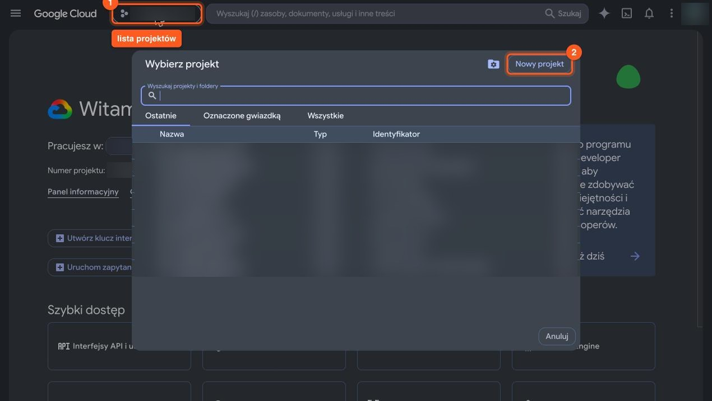

**Krok 3.** Wpiszcie nazwę projektu, np. `nh-komentarze` (1), i kliknijcie **Utwórz** (2). Pole **Zasób nadrzędny** zostawcie bez zmian (*Brak organizacji*).

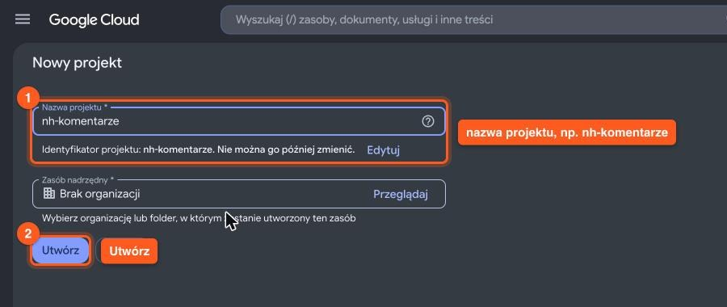

**Krok 4.** Po kilku sekundach w prawym górnym rogu pojawi się powiadomienie. Kliknijcie **Wybierz projekt** (3). Teraz pracujecie w nowym projekcie.

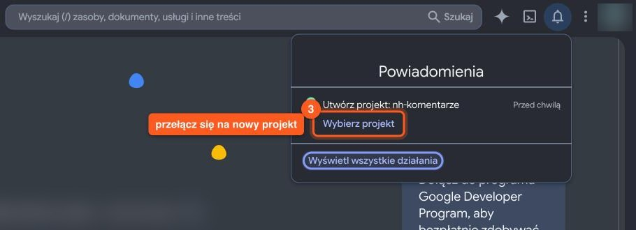

**Krok 5.** Otwórzcie menu **☰ → Interfejsy API i usługi → Biblioteka**. Sprawdźcie u góry, czy wybrany jest nowy projekt. W polu wyszukiwania wpiszcie `YouTube Data API v3` i naciśnijcie Enter (1), a potem kliknijcie kafelek **YouTube Data API v3**.

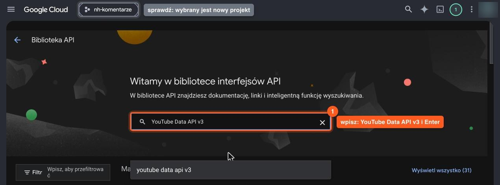

**Krok 6.** Kliknijcie **Włącz** (2).

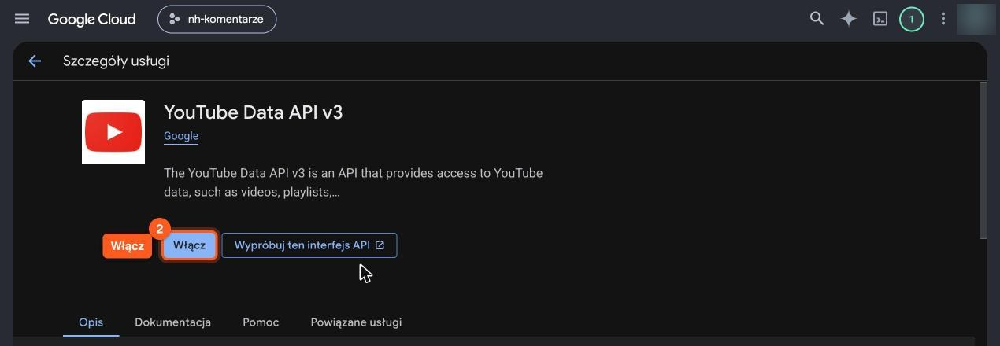

**Krok 7.** Na stronie interfejsu przy **Stan** widać **Włączono**. Po lewej kliknijcie **Dane logowania** (3).

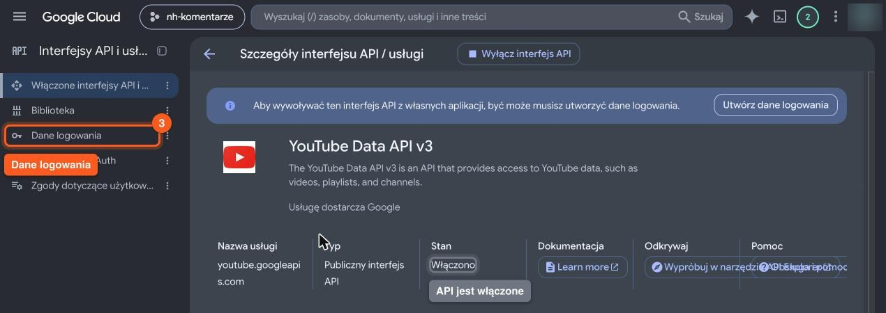

**Krok 8.** Kliknijcie **+ Utwórz dane logowania** (4) → **Klucz interfejsu API** (5). Żółtą ramkę o ekranie zgody OAuth pomińcie: dotyczy aplikacji, w których logują się użytkownicy.

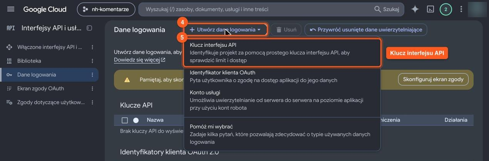

**Krok 9.** Po prawej otworzy się panel. Wpiszcie nazwę klucza, np. `youtube-komentarze` (6). W polu **Wybierz ograniczenia interfejsu API** wpiszcie w filtrze `YouTube`, zaznaczcie **YouTube Data API v3** (7) i kliknijcie **OK** (8). Wtedy klucz działa tylko dla YouTube i nie da się nim użyć innych usług Google.

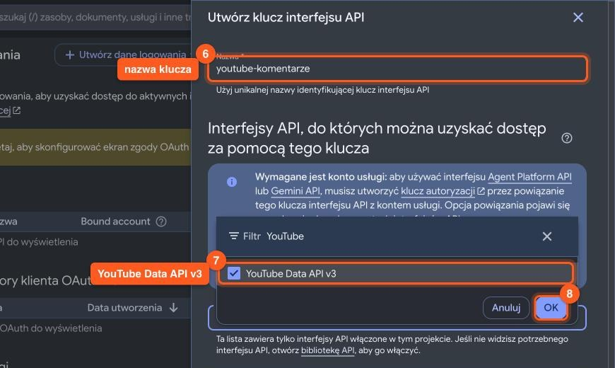

**Krok 10.** Przewińcie panel w dół. Sprawdźcie, że w **Wybrane interfejsy API** jest YouTube Data API v3, a w **Ograniczenia aplikacji** zostało **Brak**. Kliknijcie **Utwórz** (9).

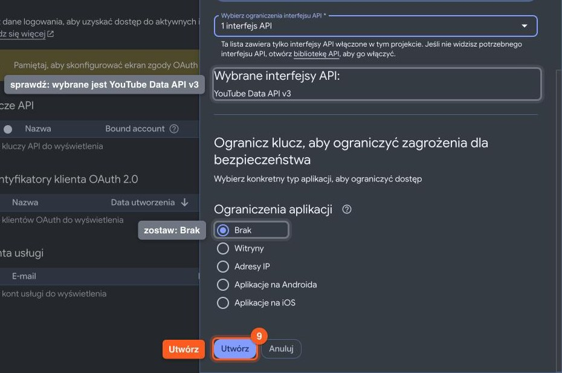

**Krok 11.** Google pokaże gotowy klucz. Kliknijcie ikonę kopiowania (10). Na zrzucie klucz jest zamazany, u was będzie widoczny.

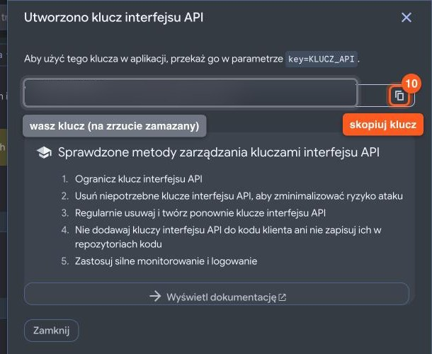

> [!WARNING]
> **Klucz wklejacie tylko w jedno miejsce: do sekretu na GitHubie (część B).** Nie do notatnika, czatu, Issue ani maila. Kto ma klucz, może zużyć wasz limit. Jeśli klucz wycieknie, usuńcie go w Google Cloud (**Dane logowania** → kosz przy kluczu) i utwórzcie nowy. Klucz zawsze możecie podejrzeć później: **Dane logowania → Pokaż klucz**. Jeśli Google prosi o kartę płatniczą, przerwijcie i zapytajcie prowadzącego.

## Część B. Sekret w Codespaces (raz na zespół)

**Sekret** to zaszyfrowana wartość zapisana na GitHubie. Codespace dostaje ją jako zmienną środowiskową, więc kod czyta klucz przez `os.environ`, a klucz nigdy nie trafia do plików repozytorium. Sekret dodaje właściciel repozytorium (zwykle osoba A). Działa w codespace obu osób.

**Krok 12.** W repozytorium zespołu otwórzcie **Settings** → po lewej **Secrets and variables** (1) → **Codespaces** (2) i kliknijcie **New repository secret** (3).

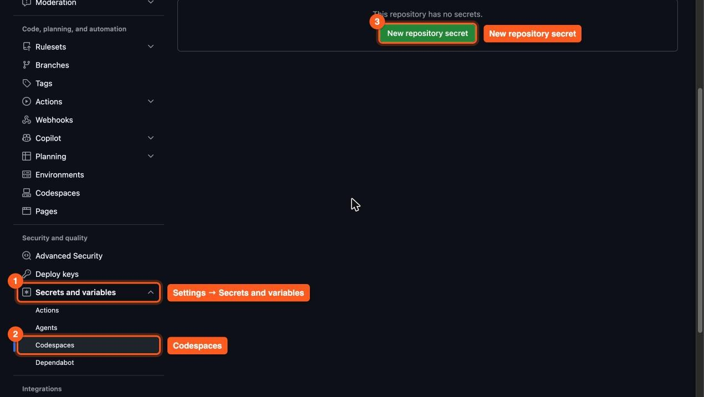

**Krok 13.** W polu **Name** wpiszcie dokładnie `YOUTUBE_API_KEY` (4). W polu **Secret** wklejcie klucz z Google Cloud (5) i kliknijcie **Add secret** (6).

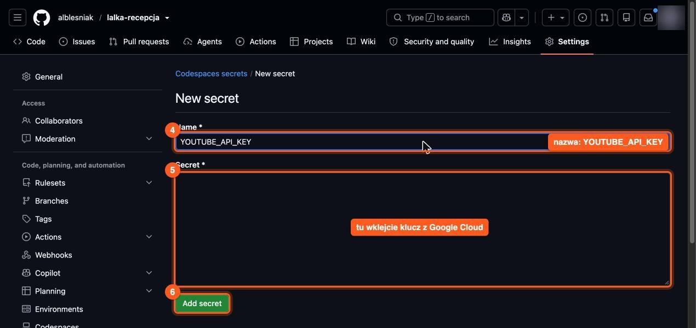

**Krok 14.** Sekret jest na liście (7). Jego wartości nie zobaczycie już na GitHubie: można ją tylko zastąpić nową.

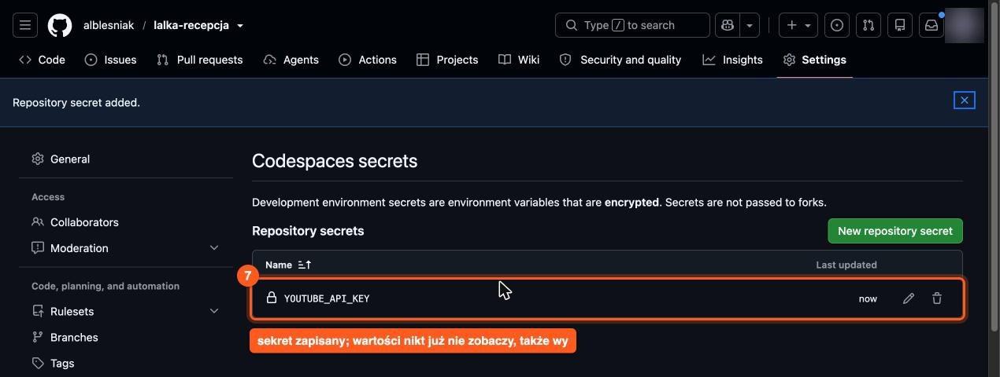

**Krok 15.** Codespace widzi nowy sekret dopiero po ponownym uruchomieniu. Jeśli był włączony: zróbcie **Commit** i **Sync**, zatrzymajcie go (**⋯ → Stop codespace**, [ćwiczenie 3](../podrecznik/03_codespaces.md)) i otwórzcie ponownie.

## Część C. Pobranie próbki

**Krok 16.** Wybierzcie film i sprawdźcie, czy ma włączone komentarze. Pod filmem kliknijcie **Udostępnij** i **Kopiuj** (2). Adres ma postać `https://youtu.be/` i 11 znaków: to **ID filmu**. Dopisek `?si=…` na końcu nie przeszkadza.

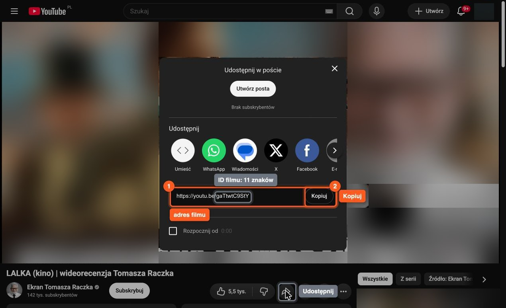

**Krok 17.** W codespace otwórzcie notatnik `notebooks/01_pobranie.ipynb` (albo utwórzcie nowy, np. `02_youtube.ipynb`) i wybierzcie jądro **Python 3.12** ([ćwiczenie 4](../podrecznik/04_notatniki.md)). Wklejcie kod wzorcowy z końca przepisu: cztery komórki, jedna pod drugą. Możecie też poprosić Copilota w Czacie, np.:

```
Napisz kod do notatnika, który pobiera 100 komentarzy spod filmu https://youtu.be/… przez YouTube Data API v3
(commentThreads.list, part=snippet, textFormat=plainText). Klucz w os.environ["YOUTUBE_API_KEY"].
Zapisz każdą stronę odpowiedzi jako JSON w ../data/raw/, zamień nicki na autor_001…
(słownik zamian tylko w data/raw/) i zbuduj tabelę: tekst, data publikacji, polubienia.
```

Jeśli kod pisze Copilot, sprawdźcie: czy klucz jest czytany z `os.environ` i nigdzie nie jest wypisywany, czy jest przerwa między zapytaniami i czy kod korzysta z `nextPageToken`, żeby pobrać więcej niż 100 komentarzy.

**Krok 18.** W pierwszej komórce wpiszcie adres swojego filmu (1) i uruchomcie ją (**Shift+Enter**). Pod komórką powinno się pojawić `✅ Klucz jest dostępny.` i ID filmu (2). Jeśli widzicie `❌ Brak sekretu`, wróćcie do kroku 15.

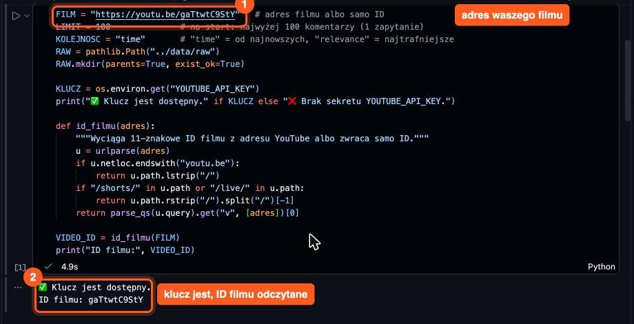

**Krok 19.** Uruchomcie komórkę z pobieraniem i komórkę z pseudonimizacją. Jedno zapytanie przyniosło 100 komentarzy i zapisało surową odpowiedź w `data/raw/` (3). Pseudonimizacja zamieniła 94 różne nicki na identyfikatory `autor_001`, `autor_002`… (4).

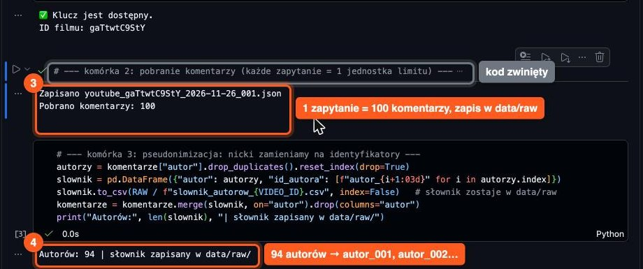

**Krok 20.** Ostatnia komórka pokazuje tabelę: 100 wierszy i 10 kolumn (1). Zamiast nicków jest kolumna `id_autora` (2). Przeczytajcie kilka tekstów (na zrzucie skrócone do 60 znaków): czy to komentarze pod tym filmem i czy polskie znaki są czytelne?

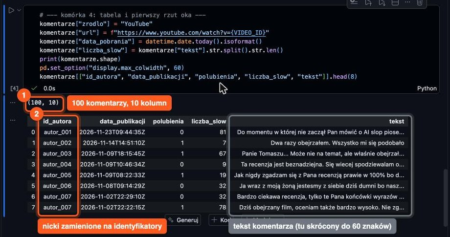

**Krok 21.** W **Eksploratorze** otwórzcie `data/raw/`: jest tam odpowiedź API w JSON i słownik nicków w CSV (5). Pliki są szare, bo folder `data/raw/` jest w `.gitignore` i nie trafia do repozytorium. Dzięki temu nicki nie wyjdą poza wasz codespace.

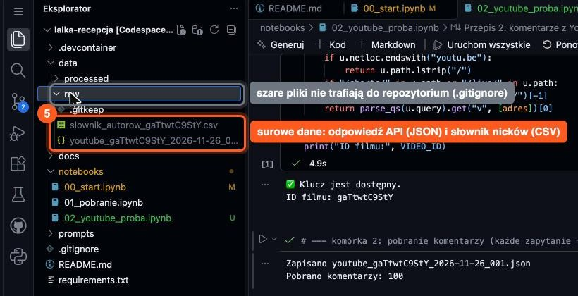

Dopiero gdy próbka jest dobra, zwiększcie `LIMIT`. Decyzję (film, liczba komentarzy, data pobrania) zapiszcie w dzienniku decyzji w `README.md`.

## Po uruchomieniu powinniście zobaczyć

- `✅ Klucz jest dostępny.` i 11-znakowe ID filmu.
- `Zapisano youtube_<ID>_<data>_001.json` i `Pobrano komentarzy: 100` (albo mniej, jeśli film ma mniej komentarzy).
- `Autorów: …`: liczbę różnych autorów. W przykładzie 94 na 100 komentarzy.
- Tabelę z najwyżej `LIMIT` wierszami i kolumną `id_autora` zamiast nicków.

**Typowe błędy** (kod wzorcowy wypisuje kod błędu i przyczynę):

| Komunikat | Co znaczy | Co zrobić |
|---|---|---|
| `❌ Brak sekretu YOUTUBE_API_KEY` | codespace nie widzi sekretu | sprawdźcie nazwę sekretu (krok 13) i uruchomcie codespace ponownie (krok 15) |
| `403 … commentsDisabled` | komentarze pod filmem są wyłączone | wybierzcie inny film |
| `403 … quotaExceeded` | wyczerpany dzienny limit | poczekajcie do następnego dnia (limit odnawia się o północy czasu pacyficznego) |
| `403 … accessNotConfigured` albo „Requests to this API … are blocked” | API nie jest włączone w projekcie albo klucz ograniczono do innego API | sprawdźcie kroki 4–6 i 9 |
| `400 … API key not valid` | zły klucz albo nieodświeżony codespace | wklejcie klucz jeszcze raz (**Update** przy sekrecie) i uruchomcie codespace ponownie |
| `404 … videoNotFound` | złe ID filmu | sprawdźcie adres |

<details>
<summary>▶ Kod wzorcowy (uruchomiony na prawdziwym API 26.11.2026)</summary>

```python
# --- komórka 1: parametry ---
import os, json, time, datetime, pathlib
from urllib.parse import urlparse, parse_qs
import requests
import pandas as pd

FILM = "https://youtu.be/gaTtwtC9StY"   # adres waszego filmu albo samo ID
LIMIT = 100              # na start: najwyżej 100 komentarzy (1 zapytanie)
KOLEJNOSC = "time"       # "time" = od najnowszych, "relevance" = najtrafniejsze
RAW = pathlib.Path("../data/raw")
RAW.mkdir(parents=True, exist_ok=True)

KLUCZ = os.environ.get("YOUTUBE_API_KEY")
print("✅ Klucz jest dostępny." if KLUCZ else "❌ Brak sekretu YOUTUBE_API_KEY.")

def id_filmu(adres):
    """Wyciąga 11-znakowe ID filmu z adresu YouTube albo zwraca samo ID."""
    u = urlparse(adres)
    if u.netloc.endswith("youtu.be"):
        return u.path.lstrip("/")
    if "/shorts/" in u.path or "/live/" in u.path:
        return u.path.rstrip("/").split("/")[-1]
    return parse_qs(u.query).get("v", [adres])[0]

VIDEO_ID = id_filmu(FILM)
print("ID filmu:", VIDEO_ID)
```

```python
# --- komórka 2: pobranie komentarzy (każde zapytanie = 1 jednostka limitu) ---
def pobierz_komentarze(video_id, limit):
    adres = "https://www.googleapis.com/youtube/v3/commentThreads"
    parametry = {"part": "snippet", "videoId": video_id, "maxResults": 100,
                 "order": KOLEJNOSC, "textFormat": "plainText", "key": KLUCZ}
    wiersze, strona = [], 0
    while len(wiersze) < limit:
        odp = requests.get(adres, params=parametry, timeout=30)
        dane = odp.json()
        if odp.status_code != 200:
            # Nie wypisujemy adresu zapytania, bo zawiera klucz.
            blad = dane.get("error", {})
            print("❌ Błąd", odp.status_code, "|", blad.get("message", ""),
                  "|", [e.get("reason") for e in blad.get("errors", [])])
            break
        strona += 1
        plik = RAW / f"youtube_{video_id}_{datetime.date.today()}_{strona:03d}.json"
        plik.write_text(json.dumps(dane, ensure_ascii=False), encoding="utf-8")
        print("Zapisano", plik.name)
        for watek in dane.get("items", []):
            k = watek["snippet"]["topLevelComment"]["snippet"]
            wiersze.append({
                "id": watek["id"],
                "tekst": k["textDisplay"],
                "autor": k["authorDisplayName"],
                "data_publikacji": k["publishedAt"],
                "polubienia": k["likeCount"],
                "liczba_odpowiedzi": watek["snippet"].get("totalReplyCount", 0),
            })
        token = dane.get("nextPageToken")
        if not token:
            break
        parametry["pageToken"] = token
        time.sleep(1)
    return wiersze[:limit]

komentarze = pd.DataFrame(pobierz_komentarze(VIDEO_ID, LIMIT))
print("Pobrano komentarzy:", len(komentarze))
```

```python
# --- komórka 3: pseudonimizacja: nicki zamieniamy na identyfikatory ---
autorzy = komentarze["autor"].drop_duplicates().reset_index(drop=True)
slownik = pd.DataFrame({"autor": autorzy, "id_autora": [f"autor_{i+1:03d}" for i in autorzy.index]})
slownik.to_csv(RAW / f"slownik_autorow_{VIDEO_ID}.csv", index=False)   # słownik zostaje w data/raw
komentarze = komentarze.merge(slownik, on="autor").drop(columns="autor")
print("Autorów:", len(slownik), "| słownik zapisany w data/raw/")
```

```python
# --- komórka 4: tabela i pierwszy rzut oka ---
komentarze["zrodlo"] = "YouTube"
komentarze["url"] = f"https://www.youtube.com/watch?v={VIDEO_ID}"
komentarze["data_pobrania"] = datetime.date.today().isoformat()
komentarze["liczba_slow"] = komentarze["tekst"].str.split().str.len()
print(komentarze.shape)
pd.set_option("display.max_colwidth", 60)
komentarze[["id_autora", "data_publikacji", "polubienia", "liczba_slow", "tekst"]].head(8)
```

</details>

## Prawo i etyka

- **Nicki to dane osobowe.** Kod wzorcowy zamienia je na identyfikatory od razu po pobraniu (komórka 3). Słownik zamian zostaje w `data/raw/`. Do `data/processed/` i na stronę trafiają tylko dane z `id_autora`.
- **Czas przechowywania.** [Zasady dla deweloperów YouTube](https://developers.google.com/youtube/terms/developer-policies) ograniczają przechowywanie danych z API: po 30 dniach trzeba je usunąć albo pobrać od nowa. Przeczytajcie aktualne brzmienie, zapiszcie decyzję w karcie źródła (pole „Przechowywanie”) i w dzienniku decyzji. Publikujemy dane zbiorcze i krótkie cytaty bez nicków.
- **Odpowiedzi pod komentarzami** API zwraca tylko częściowo. Jeśli są ważne dla pytania badawczego, poproście Copilota o pobranie ich metodą `comments.list` z parametrem `parentId`.
- **Wyszukiwanie filmów** przez API (`search.list`) kosztuje 100 jednostek za zapytanie. Listę filmów lepiej przygotować ręcznie.

[← Przepis 1](01_api_bez_klucza.md) · [Przepisy](README.md) · [Przepis 3: scraping →](03_scraping.md)
