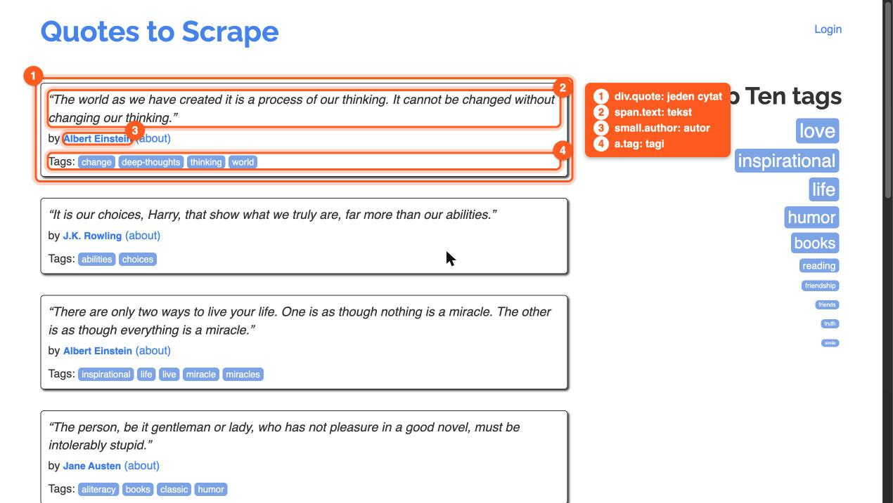
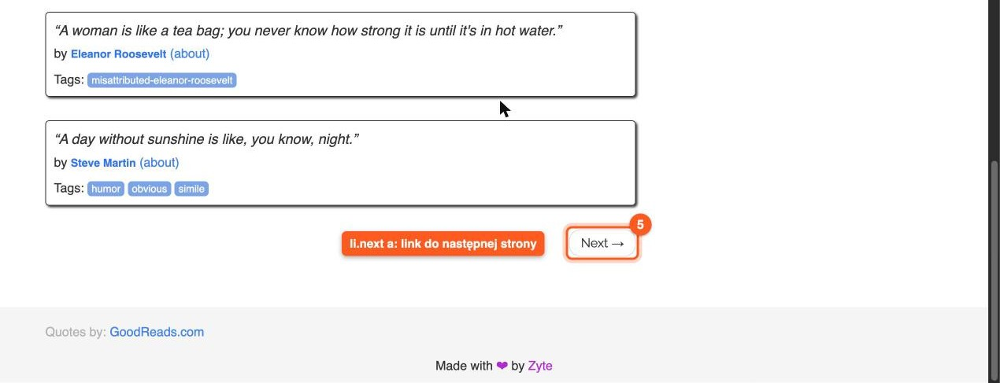

# Przepis 3. Piszemy scraper

**Kiedy:** teksty są tylko na stronach WWW, a serwis nie ma API. Ćwiczymy na [quotes.toscrape.com](https://quotes.toscrape.com/), stronie zrobionej do nauki scrapingu: cytaty z autorem i tagami, po 10 na stronę.
**Wynik:** scraper w notatniku, który przechodzi przez kolejne strony, zapisuje surowy HTML w `data/raw/` i tabelę `cytaty` w `data/processed/cytaty.csv`.
**Czas:** ok. 45 minut.

> [!NOTE]
> **Scraper** to program, który robi to samo co wy w przeglądarce: pobiera stronę, znajduje na niej potrzebne fragmenty i zapisuje je w tabeli. Potrzebuje dwóch bibliotek: `requests` (pobiera stronę) i `BeautifulSoup` (szuka w niej elementów). Obie są już w codespace.

Każdy krok to jedna komórka w notatniku `notebooks/01_pobranie.ipynb` (albo w nowym notatniku). Wklejcie ją, uruchomcie (**Shift+Enter**) i porównajcie wynik z tym, co powinno się pokazać. Nie rozumiecie jakiejś linijki? Zaznaczcie ją i zapytajcie Copilota w Czacie: „co robi ta linijka?”.

## Krok 1. Obejrzyjcie stronę jak program

Otwórzcie [quotes.toscrape.com](https://quotes.toscrape.com/). Kliknijcie prawym przyciskiem na tekst cytatu → **Zbadaj** (*Inspect*). Otworzy się panel z kodem strony, a podświetlony element to ten, w który kliknęliście. Szukacie elementu, który obejmuje **jeden cały cytat**, i elementów z jego częściami:



| Nr | Co | Selektor | Jak to wygląda w kodzie strony |
|---|---|---|---|
| 1 | jeden cytat | `div.quote` | `<div class="quote">` |
| 2 | tekst | `span.text` | `<span class="text">` |
| 3 | autor | `small.author` | `<small class="author">` |
| 4 | tagi | `a.tag` | `<a class="tag">` |

**Selektor** to krótki zapis „znacznik.klasa”: `div.quote` oznacza znacznik `<div>` z klasą `quote`. Na dole strony jest jeszcze link do następnej strony, `li.next a` (5):



## Krok 2. Biblioteki i adres

```python
# --- komórka 1: biblioteki i adres ---
import time, datetime, pathlib
from urllib.parse import urljoin
import requests
import pandas as pd
from bs4 import BeautifulSoup

START = "https://quotes.toscrape.com/"
NAGLOWKI = {"User-Agent": "projekt-studencki-nowa-humanistyka (cele edukacyjne)"}
RAW = pathlib.Path("../data/raw")
RAW.mkdir(parents=True, exist_ok=True)
```

Nic się nie wypisze: komórka tylko przygotowuje narzędzia. `NAGLOWKI` to wizytówka programu: serwer widzi, kto pyta.

## Krok 3. Pobierzcie jedną stronę

```python
# --- komórka 2: pobierz jedną stronę ---
odp = requests.get(START, headers=NAGLOWKI, timeout=30)
print("Status:", odp.status_code)          # 200 znaczy: strona przyszła
print("Długość HTML:", len(odp.text), "znaków")
print(odp.text[:200])                      # początek kodu strony
```

**Powinno się pokazać:** `Status: 200`, `Długość HTML: 11021 znaków` (mniej więcej) i początek kodu strony z `<title>Quotes to Scrape</title>`. To jest dokładnie to, co widzi przeglądarka, zanim ułoży stronę.

## Krok 4. Znajdźcie cytaty

```python
# --- komórka 3: znajdź cytaty na stronie ---
zupa = BeautifulSoup(odp.text, "lxml")
bloki = zupa.select("div.quote")           # selektor z kroku 1
print("Cytatów na stronie:", len(bloki))
pierwszy = bloki[0]
print(pierwszy.select_one("span.text").get_text(strip=True))
print(pierwszy.select_one("small.author").get_text(strip=True))
```

**Powinno się pokazać:** `Cytatów na stronie: 10`, tekst pierwszego cytatu (*The world as we have created it…*) i `Albert Einstein`. `select` znajduje wszystkie pasujące elementy, `select_one` pierwszy, a `get_text` wyciąga z elementu sam tekst.

## Krok 5. Wszystkie cytaty z jednej strony do tabeli

```python
# --- komórka 4: wszystkie cytaty z jednej strony do tabeli ---
def wyciagnij(html, url):
    """Z jednej strony HTML robi listę wierszy: jeden cytat = jeden wiersz."""
    wiersze = []
    for blok in BeautifulSoup(html, "lxml").select("div.quote"):
        tekst = blok.select_one("span.text").get_text(strip=True)
        wiersze.append({
            "tekst": tekst,
            "autor": blok.select_one("small.author").get_text(strip=True),
            "tagi": ", ".join(t.get_text() for t in blok.select("a.tag")),
            "url": url,
            "data_pobrania": datetime.date.today().isoformat(),
            "liczba_slow": len(tekst.split()),
        })
    return wiersze

tabela = pd.DataFrame(wyciagnij(odp.text, START))
print(tabela.shape)
tabela.head()
```

**Powinno się pokazać:** `(10, 6)` i tabela 5 pierwszych cytatów z kolumnami `tekst`, `autor`, `tagi`, `url`, `data_pobrania`, `liczba_slow`. Funkcja `wyciagnij` przyda się w następnym kroku dla każdej strony.

## Krok 6. Kolejne strony

```python
# --- komórka 5: kolejne strony: idziemy za linkiem „Next” ---
LIMIT_STRON = 3
adres, wiersze, nr = START, [], 0
while adres and nr < LIMIT_STRON:
    odp = requests.get(adres, headers=NAGLOWKI, timeout=30)
    if odp.status_code != 200:
        print("Błąd", odp.status_code, "przy", adres)
        break
    nr += 1
    (RAW / f"strona_{nr:03d}.html").write_text(odp.text, encoding="utf-8")   # surowy HTML
    wiersze += wyciagnij(odp.text, adres)
    nastepna = BeautifulSoup(odp.text, "lxml").select_one("li.next a")
    adres = urljoin(adres, nastepna["href"]) if nastepna else None
    print("Pobrano stronę", nr, "| cytatów razem:", len(wiersze))
    time.sleep(1)                              # przerwa między stronami

cytaty = pd.DataFrame(wiersze)
print(cytaty.shape)
cytaty.head()
```

**Powinno się pokazać:** trzy linijki `Pobrano stronę 1 | cytatów razem: 10` … `30`, potem `(30, 6)` i tabela. W **Eksploratorze**, w `data/raw/`, są pliki `strona_001.html` … `strona_003.html`. Pętla kończy się, gdy osiągnie `LIMIT_STRON` albo gdy na stronie nie ma już linku „Next”. Przerwa `time.sleep(1)` sprawia, że scraper nie zasypuje serwera zapytaniami.

## Krok 7. Zapiszcie tabelę

```python
# --- komórka 6: zapis tabeli ---
cytaty.to_csv("../data/processed/cytaty.csv", index=False)
print("Zapisano", len(cytaty), "wierszy do data/processed/cytaty.csv")
```

**Powinno się pokazać:** `Zapisano 30 wierszy do data/processed/cytaty.csv`. Teraz **Zatwierdź** i **Synchronizuj zmiany**: do repozytorium trafia notatnik i tabela, a surowy HTML zostaje w `data/raw/`.

## Wasza kolej

1. Zmieńcie `LIMIT_STRON` na `5`. Ile cytatów macie teraz?
2. Dodajcie kolumnę z linkiem do strony autora. Wskazówka: link „(about)” to `blok.select_one("span a")["href"]`, a pełny adres daje `urljoin(START, …)`.
3. Pobierzcie tylko cytaty z tagiem *love*: ustawcie `START = "https://quotes.toscrape.com/tag/love/"`.
4. Dla chętnych: druga strona do ćwiczeń, [books.toscrape.com](https://books.toscrape.com/). Zbierzcie tytuły i ceny książek: każda książka to `article.product_pod`, tytuł jest w atrybucie `title` elementu `h3 a`, cena w `p.price_color`. Jeśli przy cenie zobaczycie `£` zamiast `£`, dopiszcie po pobraniu strony `odp.encoding = "utf-8"`.

**Typowe kłopoty:**

| Objaw | Co znaczy | Co zrobić |
|---|---|---|
| `Cytatów na stronie: 0` | literówka w selektorze | porównajcie z tabelą w kroku 1: kropka przed klasą, bez spacji |
| `AttributeError: 'NoneType' object has no attribute 'get_text'` | `select_one` niczego nie znalazł | sprawdźcie selektor tego jednego pola w **Zbadaj** |
| `NameError: name 'wyciagnij' is not defined` | pominięta komórka z kroku 5 | uruchomcie komórki po kolei od góry |
| krzaki zamiast liter | strona w innym kodowaniu, niż zgadł `requests` | `odp.encoding = "utf-8"` |

## Później: prawdziwy portal

1. **Czy wolno?** Zanim napiszecie scraper dla prawdziwego serwisu, sprawdźcie jego regulamin i `https://adres-portalu/robots.txt`. Jeśli regulamin zabrania botów (jak Filmweb), scrapera nie piszemy: zostaje [ręczna próbka](04_reczna_probka.md).
2. **Czy tekst jest w HTML?** Otwórzcie stronę z tekstami, naciśnijcie **Ctrl+U** (na Macu **Cmd+Option+U**), czyli źródło strony, i wyszukajcie (**Ctrl+F**) fragment komentarza albo recenzji.
    - **Jest** → scraper jak w krokach 3–6: selektory znajdziecie przez **Zbadaj**.
    - **Nie ma** → tekst dociąga JavaScript i `requests` go nie zobaczy. Sprawdźcie, czy serwis ma oficjalne API, i porozmawiajcie z prowadzącym. Nie korzystajcie z ukrytych, nieopisanych adresów serwisu bez sprawdzenia regulaminu.
3. **Selektory.** Przez **Zbadaj** znajdźcie element, w którym jest jeden tekst (recenzja, komentarz), i elementy z autorem, datą, oceną. Wypiszcie ich klasy i podstawcie je w miejsce `div.quote`, `span.text` i `small.author` z kroków 4–5.
4. **Próbka**: najwyżej 2–3 strony, przerwa co najmniej 1 sekunda. Obejrzyjcie tabelę: czy teksty nie są ucięte, czy nie zebrały się menu i stopki.
5. **Skala** dopiero po sprawdzeniu próbki. Przy dużej liczbie stron zapisujcie postęp (które strony już pobrano), żeby po przerwie nie zaczynać od nowa.

> [!WARNING]
> **Kiedy przestać:** strona wymaga logowania, pokazuje CAPTCHA, ma paywall, zwraca błąd **403** (brak dostępu) albo **429** (za dużo zapytań), albo regulamin zabrania programów (botów). Nie obchodzimy tych zabezpieczeń: przerywamy, zapisujemy to w karcie źródła i przechodzimy do [ręcznej próbki](04_reczna_probka.md). Tak jest z Filmwebem i Reddittem.

[← Przepis 2](02_youtube.md) · [Przepisy](README.md) · [Przepis 4: ręczna próbka →](04_reczna_probka.md)
