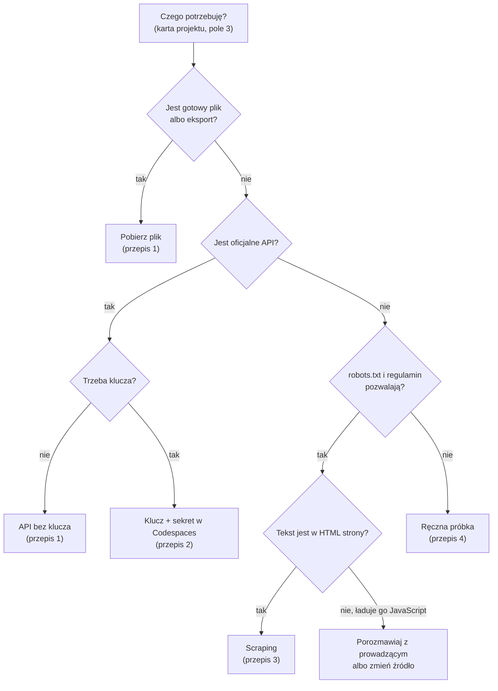

# Przepisy: skąd wziąć dane

Przepis to tutorial: krok po kroku, z kodem do wklejenia do notatnika i z wynikiem, który powinien się pokazać.

## Na laboratorium: wybierzcie jedną drogę

| Droga | Tutorial | Co pobieracie | Co potrzeba |
|---|---|---|---|
| **API** | [2. Komentarze z YouTube](02_youtube.md) | komentarze pod filmem o „Lalce” | klucz API (część A przepisu, ok. 10 minut) |
| **Scraper** | [3. Piszemy scraper](03_scraping.md) | cytaty ze strony do ćwiczeń, potem dowolna strona | nic, tylko notatnik |
| rozgrzewka | [1. API bez klucza](01_api_bez_klucza.md) | tekst „Lalki” z Wolnych Lektur | nic |

Na koniec: karta projektu (pola 1–4 w `README.md`), **Zatwierdź** i **Synchronizuj zmiany**.

## Cztery drogi do danych

| Droga | Kiedy | Przykład | Przepis |
|---|---|---|---|
| **Gotowy plik lub eksport** | serwis udostępnia pliki do pobrania | Wolne Lektury: TXT, EPUB | [1. API bez klucza](01_api_bez_klucza.md) |
| **Oficjalne API** | serwis ma interfejs dla programów; czasem trzeba założyć klucz | YouTube Data API | [2. Komentarze z YouTube](02_youtube.md) |
| **Scraping** | dane są tylko na stronach WWW, a regulamin i `robots.txt` na to pozwalają | strony bez zakazu botów | [3. Scraping strony](03_scraping.md) |
| **Ręczna próbka** | API jest niedostępne, a regulamin albo `robots.txt` zabrania programów | Filmweb, Reddit | [4. Ręczna próbka](04_reczna_probka.md) |

Zawsze wybierajcie drogę **najwyżej** w tabeli. API jest stabilniejsze i bezpieczniejsze prawnie niż scraping, a gotowy plik jest prostszy niż API. Ręczna próbka jest ostatnia, ale w pełni uprawniona: kilkadziesiąt dobrze dobranych tekstów to w humanistyce normalna próba.

## Wspólny projekt „Lalka”: od warstwy do przepisu

| Warstwa | Źródło | Karta źródła | Przepis |
|---|---|---|---|
| `lalka-powiesc` | Wolne Lektury | [gotowa](../../prompts/karty/lalka_powiesc_wolne_lektury.md) | [1. API bez klucza](01_api_bez_klucza.md) |
| `lalka-recepcja` | YouTube | [gotowa](../../prompts/karty/lalka_recepcja_youtube.md) | [2. Komentarze z YouTube](02_youtube.md) |
| `lalka-recepcja` | Filmweb | [gotowa](../../prompts/karty/lalka_recepcja_filmweb.md) | [4. Ręczna próbka](04_reczna_probka.md) |
| `lalka-recepcja` | Reddit | [gotowa](../../prompts/karty/lalka_recepcja_reddit.md) | [4. Ręczna próbka](04_reczna_probka.md) |
| `lalka-recepcja` | dawna prasa | [do rozpoznania](../../prompts/karty/lalka_recepcja_prasa.md) | `/zrodlo`, potem 3 albo 4 |
| `lalka-ekran` | serwisy z filmami | [otwarte pytanie](../../prompts/karty/lalka_ekran_dialogi.md) | decyzja z prowadzącym |

Każde źródło przechodzi ten sam workflow: **karta → przepis → próbka → kontrola → Commit**. Gotową kartę kopiujecie jako `prompts/karta_zrodla_v1.md` i uzupełniacie adresy. Źródło bez karty zaczynacie od `/zrodlo`. Wszystkie karty: [prompts/karty/](../../prompts/karty/README.md).

## Rytm pracy: plan → próbka → sprawdzenie → skala

1. **Plan.** Ustalcie, co pobieracie, skąd i ile (karta projektu, pole 3).
2. **Próbka.** Kod z przepisu (albo od Copilota) wklejacie do notatnika, uruchamiacie i oglądacie wynik oczami: czy to są te teksty, czy polskie znaki są czytelne, czy nie ma pustych wierszy.
3. **Sprawdzenie.** Porównajcie wynik z sekcją „Powinno się pokazać” w przepisie. Błąd? Wklejcie go do Czatu Copilota i zapytajcie, co znaczy.
4. **Skala.** Dopiero gdy próbka jest dobra, zwiększacie limit. Decyzję i datę pobrania zapisujecie w dzienniku decyzji w `README.md`.

Każdy przepis prowadzi krok po kroku, ze zrzutem ekranu przy każdym kroku i z wynikiem, który powinniście zobaczyć. Na końcu ma **kod wzorcowy** (ukryty pod ▶). Zajrzyjcie do niego, gdy wasz kod nie działa albo chcecie porównać rozwiązania.

## Polecenia Copilota (dla chętnych)

| Polecenie | Co robi | Pisze kod? |
|---|---|---|
| `/zrodlo` | rozpoznanie źródła: cztery drogi, klucze, limity, regulamin, dane osobowe; szkic karty źródła | nie |
| `/pobierz` | kod pobrania małej próbki do notatnika, z zapisem do `data/raw/` | tak |
| `/koduj` | kod kodowania tekstów modelem językowym według karty kodowej | tak |
| `/wykres` | jeden wykres odpowiadający na jedno pytanie, zapis na stronę projektu | tak |
| `/wyjasnij` | wyjaśnienie zaznaczonego kodu albo komunikatu błędu po polsku | tylko poprawka |

Polecenia są zapisane w `.github/skills/`, a ogólne zasady dla asystentów AI (Copilot, Codex, Claude) w pliku [AGENTS.md](../../AGENTS.md) w głównym folderze. Działają w panelu **Czat** w codespace: wpiszcie `/`, poczekajcie chwilę na listę, dopiszcie pierwsze litery i wybierzcie polecenie. Gdy Copilot je wczyta, w odpowiedzi pojawi się znacznik **Read skill**. Zrzut ekranu: [ćwiczenie 4](../podrecznik/04_notatniki.md). Jak działają polecenia i jak napisać własne: [AI w projekcie](../podrecznik/10_ai_w_projekcie.md). Nie macie Copilota albo skończył się limit? Te same zasady możecie wkleić do dowolnego czatu AI: otwórzcie plik `SKILL.md` polecenia i skopiujcie jego treść razem z waszą prośbą.

## Prawo i etyka: przed pierwszym pobraniem

- **Regulamin serwisu**: czy pozwala na automatyczne pobieranie? Cytat i link wpiszcie do karty źródła.
- **`robots.txt`**: plik pod adresem `https://serwis/robots.txt` mówi, których ścieżek programy nie powinny odwiedzać.
- **Dane osobowe**: nicki i nazwiska prywatnych osób zamieniamy na identyfikatory (notatnik `01_pobranie`, krok 1C), a na stronę trafiają tylko krótkie cytaty bez nicków.
- **Prawa autorskie**: ustawa o prawie autorskim przewiduje wyjątki dla eksploracji tekstów i danych (art. 26² i 26³), ale nie znoszą one regulaminów ani ochrony danych osobowych. Publikujemy wyniki i krótkie cytaty, nie całe teksty.
- **Zabezpieczenia**: nie omijamy logowania, CAPTCHA, paywalli ani blokad. Jeśli serwis odpowiada błędem 403 albo 429, przerywamy i szukamy innej drogi.
- **Przechowywanie**: surowe dane zostają w `data/raw/` (poza repozytorium). Niektóre API ograniczają czas przechowywania danych, np. YouTube.

W razie wątpliwości: zapiszcie pytanie w Issue i oznaczcie prowadzącego.
