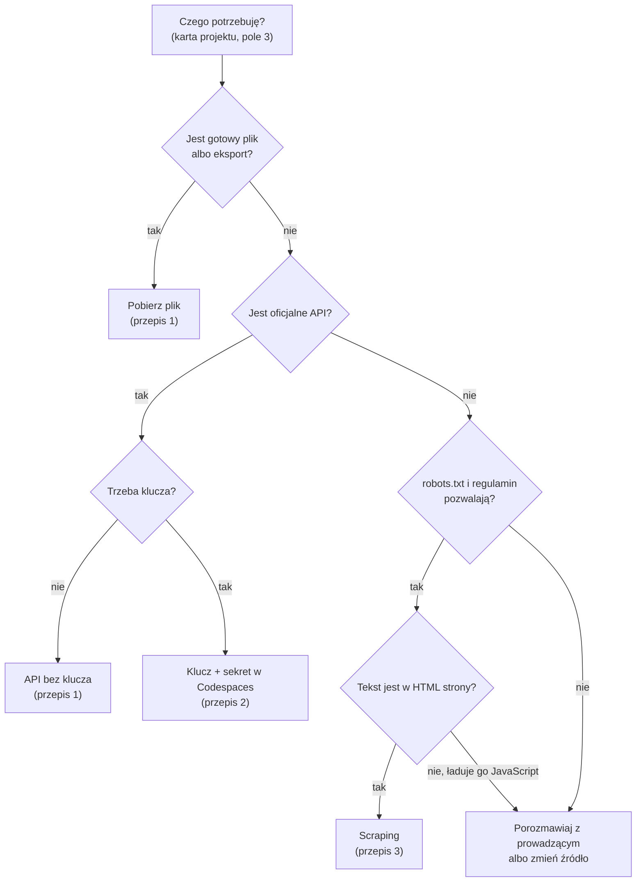

# Przepisy: skąd wziąć dane

Każdy projekt zaczyna się od pytania: **czy materiał, którego potrzebuję, w ogóle da się zdobyć, i w jaki sposób?** Te przepisy uczą, jak to sprawdzić i jak pobrać małą próbkę. Nie trzeba umieć programować: kod pisze Copilot, a wy sprawdzacie, czy robi to, co trzeba.

## Trzy drogi do danych

| Droga | Kiedy | Przykład | Przepis |
|---|---|---|---|
| **Gotowy plik lub eksport** | serwis udostępnia pliki do pobrania | Wolne Lektury: TXT, EPUB | [1. API bez klucza](01_api_bez_klucza.md) |
| **Oficjalne API** | serwis ma interfejs dla programów; czasem trzeba założyć klucz | YouTube Data API | [2. Komentarze z YouTube](02_youtube.md) |
| **Scraping** | dane są tylko na stronach WWW, a regulamin i `robots.txt` na to pozwalają | portale z recenzjami, fora | [3. Scraping strony](03_scraping.md) |

Zawsze wybierajcie drogę **najwyżej** w tabeli. API jest stabilniejsze i bezpieczniejsze prawnie niż scraping, a gotowy plik jest prostszy niż API.

## Pętla pracy z Copilotem: plan → próbka → sprawdzenie → skala

1. **Plan, bez kodu.** W Czacie Copilota wpiszcie `/zrodlo` i opiszcie, co chcecie pobrać, np. `/zrodlo komentarze pod zwiastunem serialu „Lalka” na YouTube`. Copilot porówna trzy drogi i przygotuje szkic [karty źródła](../../prompts/karta_zrodla_szablon.md).
2. **Sprawdzenie planu.** Pola karty oznaczone ✋ sprawdźcie sami w dokumentacji i regulaminie. Copilot się myli: zapiszcie w karcie, w czym.
3. **Próbka.** `/pobierz 20 komentarzy spod filmu …`. Kod wklejacie do notatnika, uruchamiacie i oglądacie wynik oczami: czy to są te teksty, czy polskie znaki są czytelne, czy nie ma pustych wierszy.
4. **Skala.** Dopiero gdy próbka jest dobra, zwiększacie limit. Decyzję i datę pobrania zapisujecie w dzienniku decyzji w `README.md`.

Przepisy poniżej mają **kod wzorcowy** (ukryty pod ▶). Zajrzyjcie do niego, gdy wasz kod nie działa albo chcecie porównać rozwiązania.

## Polecenia Copilota w tym szablonie

| Polecenie | Co robi | Pisze kod? |
|---|---|---|
| `/zrodlo` | rozpoznanie źródła: trzy drogi, klucze, limity, regulamin, dane osobowe; szkic karty źródła | nie |
| `/pobierz` | kod pobrania małej próbki do notatnika, z zapisem do `data/raw/` | tak |
| `/koduj` | kod kodowania tekstów modelem językowym według karty kodowej | tak |
| `/wykres` | jeden wykres odpowiadający na jedno pytanie, zapis na stronę projektu | tak |
| `/wyjasnij` | wyjaśnienie zaznaczonego kodu albo komunikatu błędu po polsku | tylko poprawka |

Polecenia są zapisane w `.github/skills/`, a ogólne zasady dla asystentów AI (Copilot, Codex, Claude) w pliku [AGENTS.md](../../AGENTS.md) w głównym folderze. Działają w panelu **Czat** w codespace: wpiszcie `/`, poczekajcie chwilę na listę, dopiszcie pierwsze litery i wybierzcie polecenie. Gdy Copilot je wczyta, w odpowiedzi pojawi się znacznik **Read skill**. Zrzut ekranu: [ćwiczenie 4](../podrecznik/04_notatniki.md). Jak działają polecenia i jak napisać własne: [AI w projekcie](../podrecznik/10_ai_w_projekcie.md). Nie macie Copilota albo skończył się limit? Te same zasady możecie wkleić do dowolnego czatu AI: otwórzcie plik `SKILL.md` polecenia i skopiujcie jego treść razem z waszą prośbą.

## Prawo i etyka: przed pierwszym pobraniem

- **Regulamin serwisu**: czy pozwala na automatyczne pobieranie? Cytat i link wpiszcie do karty źródła.
- **`robots.txt`**: plik pod adresem `https://serwis/robots.txt` mówi, których ścieżek programy nie powinny odwiedzać.
- **Dane osobowe**: nicki i nazwiska prywatnych osób zamieniamy na identyfikatory (notatnik `01_pobranie`, krok 1C), a na stronę trafiają tylko krótkie cytaty bez nicków.
- **Prawa autorskie**: ustawa o prawie autorskim przewiduje wyjątki dla eksploracji tekstów i danych (art. 26² i 26³), ale nie znoszą one regulaminów ani ochrony danych osobowych. Publikujemy wyniki i krótkie cytaty, nie całe teksty.
- **Zabezpieczenia**: nie omijamy logowania, CAPTCHA, paywalli ani blokad. Jeśli serwis odpowiada błędem 403 albo 429, przerywamy i szukamy innej drogi.
- **Przechowywanie**: surowe dane zostają w `data/raw/` (poza repozytorium). Niektóre API ograniczają czas przechowywania danych, np. YouTube.

W razie wątpliwości: zapiszcie pytanie w Issue i oznaczcie prowadzącego.
